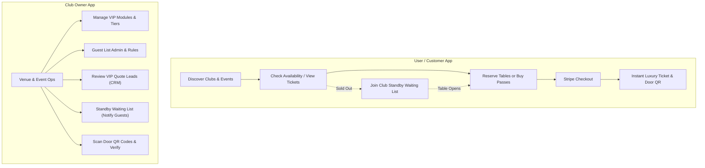

# BookDiaNight App

**Event & Club Commerce Operating System** — a comprehensive Flutter platform connecting nightlife enthusiasts with premier clubs, festivals, and VIP entertainment experiences, while providing venue owners with powerful activity, booking, and guest management tools.

---

## 📱 Platform Architecture & Overview

BookDiaNight is built as a **two-sided nightlife commerce ecosystem**:



---

## 🔄 How the Full App Works (End-to-End)

### 1. User / Customer Journey
1. **Discovery & Exploration**:
   - Filter venues and events by mood tags, music genre, date filters ("This Weekend", "Today"), and location coordinates.
   - Follow clubs to receive real-time notifications about upcoming events.
   - View past performers under **"They’ve played here"** and upcoming headliners with direct clickable **Spotify** profile buttons.
2. **Club Table Reservations**:
   - Choose start and end reservation times (validated against club opening hours in fixed CST).
   - Enter party size (number of guests).
   - Tap **Check Availability**:
     - *If tables are free*: Choose from available table packages (e.g. VIP table Pro, bottle packages).
     - *If all tables are occupied*: The app seamlessly surfaces the **Club Standby Waiting List**.
3. **Event Tickets & VIP Modules**:
   - Explore ticket tiers (Early Bird, General Admission, VIP passes) and exclusive VIP table modules.
   - For high-touch VIP requests, submit a **Quote Request** with party size, phone, WhatsApp, and custom notes.
   - Join the **Guest List** if enabled for reduced door cover or priority entry.
4. **Checkout & Instant Ticket Generation**:
   - Native Stripe payment sheet integration (`/purchase/club`, `/purchase/event`, `/purchase/module`).
   - Generates a unique `orderId` UUID.
   - Unlocks a luxury **Apple Wallet / Boarding-pass style Ticket PDF** and high-contrast **Door Entry QR Code**.
5. **Standby Queue Alerts**:
   - If in the waiting list, when a venue manager triggers a table opening alert, customers receive a push alert and a gold **"Table Available!"** action card with a direct **`[ Book Open Table Now ]`** button to secure the open spot on a first-come, first-served basis.

### 2. Club Owner & Venue Operations
1. **Activity & Event Operations**:
   - **VIP Modules CRUD**: Manage pricing, capacity, included extras (prosecco, cloakroom), optional add-ons, and availability status (`AVAILABLE`, `LIMITED`, `SOLD_OUT`).
   - **Guest List Admin**: Toggle guest list on/off (`isEnabled`), set arrival cutoffs, ID requirements, and male/female admission fallbacks.
   - **VIP Quotes CRM**: Manage incoming leads (`NEW`), review party details, initiate 1-tap phone/WhatsApp contact, and mark as `REPLIED` or `CLOSED`.
2. **Standby Waiting List Management**:
   - View waiting guests in real-time queue order (`#1`, `#2`).
   - Inspect requested time slot, date, and party size (e.g., `Target: Fri, Nov 27 · 10:00 PM (4 guests)`).
   - Send 1-tap booking alerts to guests when a table opens up.
3. **Door Scanner & Entry Verification**:
   - Built-in camera scanner (`mobile_scanner`).
   - Verifies ticket authenticity instantly via `POST /api/v1/owner/verify-ticket { "orderId": "<uuid>" }`.
4. **Earnings & Analytics**:
   - Real-time gross earnings, ticket sales counters, and recent payment logs enriched with venue and event context.

---

## ⚡ How the Recently Updated Parts Work

### 1. Club Waiting List Slot Context & Standby Flow
* **The Problem It Solved**: Previously, `POST /waiting-list/join` only sent `clubId`. The owner didn't know which day/time the user wanted, leading to confusion where users thought a table was automatically reserved, or owners notified users on the wrong day.
* **How It Works Now**:
  - When availability check returns no tables, the customer's selected date, time, and guest count are passed into `WaitingListPanel`.
  - The request payload sends:
    ```json
    POST /api/v1/waiting-list/join
    {
      "clubId": "<uuid>",
      "startAt": "2026-11-27T22:00:00.000Z",
      "guestCount": 4
    }
    ```
  - Displays a dedicated target badge: `Requested: Fri, Nov 27 · 10:00 PM – 1:00 AM (4 guests)`.
  - Clear standby disclaimer: Explains that this is an alert queue, not a guaranteed automatic reservation.
  - On the **Owner side**, the tile displays `Target: Fri, Nov 27 · 10:00 PM (4 guests)` so owners only notify relevant guests.
  - When notified, the user sees a gold `Table Available! Alert Received` banner with a direct **`[ Book Open Table Now ]`** CTA button.

### 2. VIP Module Update Schema Fix
* **The Problem It Solved**: Updating VIP modules via `PUT /event/:eventId/modules/:moduleId` returned `422 Unrecognized key: "id"` because the backend Zod validation schema is `.strict()` and expects the ID in the URL param only.
* **How It Works Now**:
  - `EventVipModuleModel.toPayload({bool includeId = false})` and `EventHostModel.toPayload({bool includeId = false})` now omit the `id` key when executing `PUT` / `POST` requests on sub-resource routes.
  - Updates save cleanly with zero validation errors.

### 3. Notification Description Full Text Display
* **The Problem It Solved**: Notification cards previously forced `maxLine: 1` with ellipsis, cutting off important venue names, table details, and time alerts (e.g. `2 gu...`).
* **How It Works Now**:
  - Subtitle text truncation was removed. Multi-line descriptions wrap naturally with line height `1.35`.
  - Card layout uses top-aligned layout (`CrossAxisAlignment.start`) for badges and timestamps.

### 4. Lineup Artist Spotify Integration
* **The Problem It Solved**: Followers count on artist tiles felt redundant; users wanted an immediate way to preview artists' music.
* **How It Works Now**:
  - Followers count removed from event lineup.
  - Each artist features a branded green **`[ ▶ Spotify ]`** pill button.
  - Automatically parses `spotifyUrl` from both flat and nested artist payloads and launches the Spotify app/web via `url_launcher`.

### 5. Enriched Owner Activity & Payments
* Owner payments (`/owner/payments`) and quotes (`/quotes`) now surface both event/club context and tier names cleanly without missing data or duplicate labels.

---

## 🛠 Tech Stack

| Layer | Technologies |
|---|---|
| **Framework** | Flutter 3.x (Dart 3.x) |
| **State Management & Routing** | GetX |
| **Networking & HTTP** | Dio (`BaseClient`, custom auth & logging interceptors) |
| **Local Storage** | GetStorage / SharedPreferences |
| **Authentication** | Firebase Auth (Google Sign-In, Apple Sign-In), Guest Gate |
| **Payments** | Flutter Stripe (PaymentSheet & Stripe Connect onboarding) |
| **Push Notifications** | Firebase Cloud Messaging (FCM) + Local Notifications |
| **Media & QR** | `mobile_scanner`, `qr_flutter`, `cached_network_image`, `url_launcher` |
| **Target Backend Host** | `https://ibady.nazmul.qzz.io/api/v1` |

---

## 📂 Key Directory Map

```
lib/app/
├── core/
│   ├── auth/                      # AccountGate & session persistence
│   ├── explore/
│   │   ├── model/                 # Event commerce, offers, explore models
│   │   └── repository/            # Discovery & Event commerce repositories
│   └── network/                   # BaseClient, EndPoint definitions, error handlers
├── modules/
│   ├── club_owner_side/
│   │   ├── activity/              # VIP modules, guest list, quotes, waiting list
│   │   ├── owner_home/            # Stats, payments, earning charts
│   │   ├── stripe_connect/        # Payout onboarding setup
│   │   └── ticket_scanner/        # QR verification
│   ├── notification/              # Notifications feed & push routing
│   └── user_side/
│       ├── booking/               # Ticket summary, QR view, booking history
│       ├── club_details_view/     # Club/Event details, waiting list panel
│       └── explore/               # Discovery feed, mood filters, map
```

---

## 🧪 Testing & Verification

The project includes unit, widget, and integration tests covering API serialization, queue mutations, error boundaries, and owner operations.

Run the test suite:
```bash
flutter test test/backend_update_test.dart
```
*(All 29 test suites pass with 0 warnings or regressions).*

---

## 🚀 Running the Project

1. **Install dependencies**:
   ```bash
   flutter pub get
   ```
2. **Run on connected device / emulator**:
   ```bash
   flutter run
   ```
3. **Commit & Push to GitHub**:
   ```bash
   git add .
   git commit -m "Feat: update documentation and platform guide"
   git push origin main
   ```
