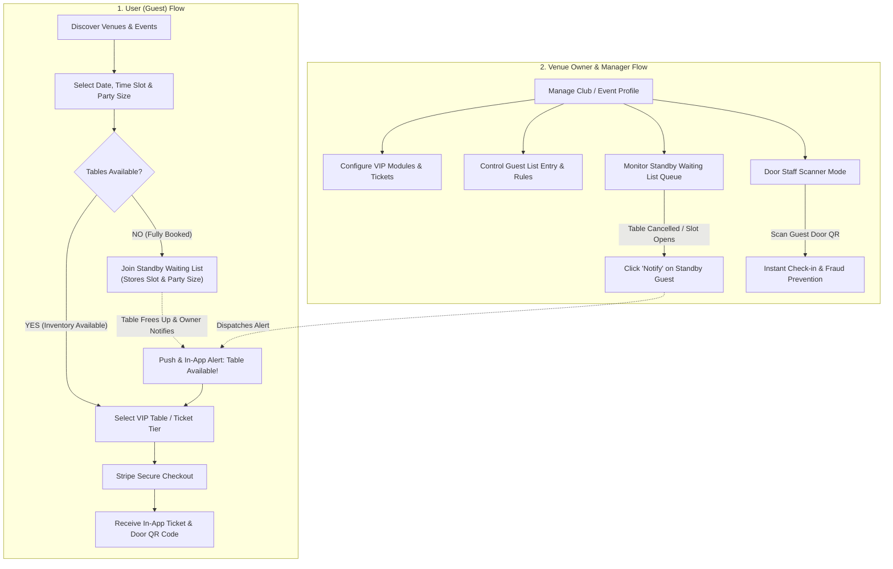

# 📖 BookDiaNight — Complete System Workflow & Operational Guide

This document provides a comprehensive end-to-end operational guide for the **BookDiaNight** platform, explaining how the system works for both **End Users (Guests)** and **Club Owners / Venue Staff**, as well as how real-time interactions operate between both sides.

---

## 🏛️ System Architecture Overview

BookDiaNight connects guests and nightlife venues through a synchronized two-sided ecosystem:



---

## 👤 1. End-User (Customer / Guest) Workflow

### Step 1: Discovery & Exploration
- **Browse & Search**: Users browse clubs, festival lineups, and DJ events filtered by vibe tags (e.g., Techno, Rooftop, Hip Hop), date ("Tonight", "This Weekend"), and location.
- **Club Details**: Inspect club photos, opening hours, dress codes, past performers ("They’ve played here"), and upcoming resident DJs with clickable Spotify profile links.

### Step 2: Table Availability & Date/Time Selection
- Guests choose:
  1. **Date & Time Slot** (validated against the venue's live schedule in fixed CST/local time).
  2. **Number of Guests** (party size).
- Tapping **Check Availability**:
  - **Scenario A (Tables Free)**: The app presents available table tiers and package options (e.g., VIP Table Pro, bottle service packages).
  - **Scenario B (Sold Out / Fully Booked)**: The app dynamically presents the **Standby Waiting List** card.

### Step 3: Standby Waiting List (Smart Queue)
- **Joining the Queue**: With 1 click, guests enter the standby queue. The mobile app automatically sends:
  - `clubId`: Venue UUID
  - `startAt`: Requested reservation ISO 8601 UTC timestamp
  - `guestCount`: Party size
- **Target Slot Visibility**: The user sees their requested slot clearly displayed without text cutoff:
  `Requested: Mon, Nov 2 · 4:00 AM – 6:00 AM · 2 guests`
- **Notice & Expectations**: Clear in-app notice clarifies that joining standby is an alert mechanism and not an automatic table reservation.
- **Queue Update**: If users change their preferred time or party size, tapping re-join updates their existing pending entry seamlessly.

### Step 4: Booking & Checkout
- For free tables or general admission passes, guests select tickets or VIP table packages.
- **High-End Custom Quotes**: For bespoke VIP areas or custom bottle service, guests submit an instant quote request (name, phone, WhatsApp, custom notes).
- **Payment**: Processed via Stripe Payment Sheet (`/purchase/club`, `/purchase/event`, `/purchase/module`).

### Step 5: Instant Pass & Door QR Code
- Upon successful transaction, an active booking entry is created with an order UUID.
- The app generates:
  - A luxury **Digital Ticket** (Apple Wallet / Boarding-pass style) with venue location, arrival time, and dress code.
  - A high-contrast **Door Entry QR Code** (encoded directly with the secure order UUID for offline/online scan).

---

## 🏢 2. Venue Owner & Manager Workflow

### Step 1: Venue & Event Management
- **Dashboard Overview**: View live revenue statistics, tonight's total reservations, and upcoming event tickets sold.
- **Event Commerce & VIP Modules**:
  - Create and edit VIP Table Modules (Guest Pass, Noble Table, Gold Pass).
  - Configure capacity, starting prices, minimum spend, venue area (e.g. "Main Courtyard"), included extras (e.g. welcome champagne), and optional add-ons.
  - Set real-time inventory status: `AVAILABLE`, `LIMITED`, `SOLD_OUT`, or `UNAVAILABLE`.
  *(Resolved: Payload strictly removes internal ID to prevent backend 422 rejections).*

### Step 2: Guest List Administration
- Venue managers can toggle guest lists on or off.
- Define arrival deadlines (e.g., "Free entry before 11:30 PM"), capacity limits, and custom door guidelines.
- Export or view registered guest list attendees.

### Step 3: Standby Waiting List Operations
- When a customer cancels or extra table space opens up, venue owners navigate to **Activity > Waiting List**.
- **Slot Context Visibility**: Owners see the guest's name, phone, queue position, and exact target slot:
  `Target: Nov 2, 04:00 AM – 06:00 AM (2 guests)`
- **One-Tap Notification**: Tapping **Notify** triggers the backend notification service (`PUT /waiting-list/:id/notify`), updating the user's status to `NOTIFIED`.

### Step 4: Door QR Scanner & Entry Verification
- Door staff use the built-in **Ticket Scanner** mode.
- Pointing the camera at the guest's door QR code immediately validates the order UUID against the backend door check-in API.
- Instant visual feedback:
  - 🟢 **Valid Pass**: Shows guest name, ticket tier, guest count, and marks ticket as redeemed.
  - 🔴 **Already Used / Invalid**: Prevents duplicate entry or unauthorized access.

---

## ⚡ 3. How the Waiting List Interacts in Real-Time

Here is the exact lifecycle of a Standby Waiting List reservation:

```
[Guest App]                          [Backend API]                         [Owner App]
     |                                     |                                    |
     |-- 1. POST /waiting-list/join ------>|                                    |
     |   { clubId, startAt, guestCount }   |                                    |
     |                                     |-- 2. Entry logged (PENDING) ------>|
     |                                     |                                    |
     |                                     |                                    | (Table cancels or
     |                                     |                                    |  extra capacity opens)
     |                                     |<-- 3. PUT /waiting-list/:id/notify-|
     |<-- 4. Status flips to NOTIFIED -----|                                    |
     |       (FCM Push + In-App Banner)    |                                    |
     |                                     |                                    |
     |-- 5. User taps [Book Open Table Now]|                                    |
     |      Redirects to live checkout     |                                    |
     |                                     |                                    |
```

1. **Guest Queues Up**: The guest cannot find a free table for Friday 11:00 PM for 4 people, so they join the standby queue.
2. **Owner Matches Needs**: On Friday night, a 4-person booth cancels. The owner opens their waiting list and spots the guest with matching party size and target time.
3. **Alert Dispatched**: Owner taps **Notify**.
4. **Guest Receives Immediate Call-to-Action**: The guest gets an instant push notification. Opening the app shows a gold badge: **`Table Available! Alert Received`** with a prominent **`[ Book Open Table Now ]`** button.
5. **First-Come Booking**: The guest immediately selects the open package and confirms their booking via Stripe.

