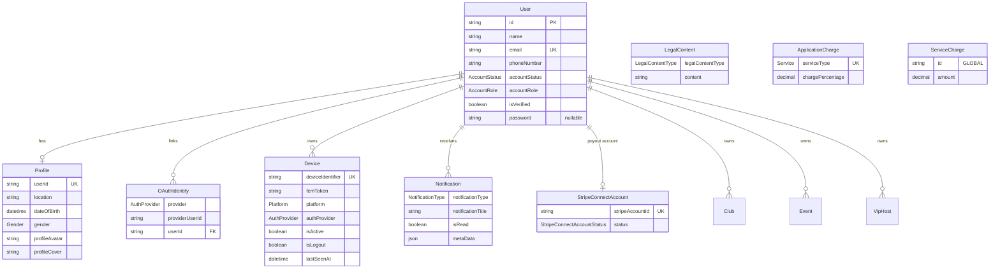
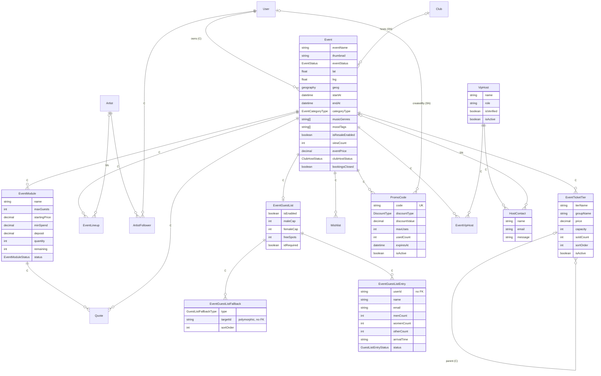
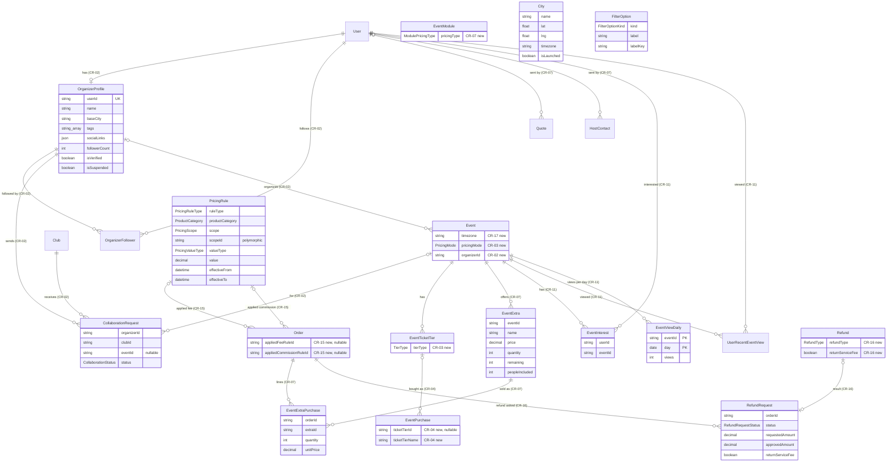

# Data Model (as-is baseline + approved TO-BE)

> Reverse-engineered from `backend/prisma/schema.prisma` (999 lines) and `backend/prisma/migrations/` (25 migrations + `migration_lock.toml`).
> Sections 1 to 7 describe the CURRENT state (as-is). **Section 8 is the TO-BE data model** for the approved change requests (`02-product/change-requests.md`: Approved CRs and the approved parts of Partial CRs; CR-05 is deferred and absent). **Section 9 is the ordered migration plan.** Every TO-BE item is tagged with its CR or BUG ID. Nothing in sections 8 and 9 exists in `schema.prisma` yet.
> See `known-issues.md` for problems (BUG-xx tags reuse its IDs).
> Items that could not be confirmed in code are marked **⚠️ UNVERIFIED**.

## 1. Overview

| Item | Value |
|---|---|
| Database | PostgreSQL 16 (dump header: 16.4 Debian) with PostGIS |
| ORM | Prisma ^6.19.2, `prisma-client-js`, preview feature `postgresqlExtensions` |
| Schema location | One schema for all three services: `backend/prisma/schema.prisma`. `server/prisma/`, `worker/prisma/`, `scheduler/prisma/` are empty mount points (`docker-compose.yaml` lines 66, 96, 130). |
| Counts | As-is: 41 models, 26 enums (verified with `grep -c "^model \|^enum "`). TO-BE (section 8): +12 models = 53, +11 enums = 37 |
| Ids | `String @id @default(uuid())` on every model except `ServiceCharge` (`@default("GLOBAL")`) |
| Timestamps | `createdAt @default(now())` and `updatedAt @updatedAt` on every model except those noted "no updatedAt" below |
| Money | `Decimal(10,2)`; rates `Decimal(5,2)`; `currency` is a free `String` |
| Geo | `geog Unsupported("geography(Point,4326)")?` on `Club` and `Event`, GiST indexed, plus plain `lat`/`lng Float` |
| Extensions in schema | `postgis, fuzzystrmatch, postgis_tiger_geocoder, postgis_topology` (`schema.prisma:13`) |
| Extensions in migrations only | `btree_gist` (migration `20260923111443_booking_payment_foundation`) |
| Other raw SQL | `backend/scripts/seed-legal.sql` seeds `LegalContent` and `ApplicationCharge` (EVENT and CLUB at 10%) |
| Dump | `backend/bookdianight.dump`: PostgreSQL custom-format dump (`PGDMP` v1.15), database `bookdianight`. Not parsed. |

Legend used below: **C** = Cascade, **R** = Restrict, **SN** = SetNull, `uq` = unique, `ix` = index.

## 2. ERD (split by domain)

> TO-BE additions are drawn in section 8.7 (new and changed entities only); sections 2.1 to 2.4 are the as-is diagrams.

### 2.1 Accounts and config



`LegalContent`, `ApplicationCharge` and `ServiceCharge` have no relations (global config tables).

### 2.2 Clubs


### 2.3 Events and extras



### 2.4 Orders and payments


`WebhookEvent` has no relations (Stripe event dedupe log).

## 3. Enums (26)

| Enum | Values |
|---|---|
| AccountStatus | ACTIVE, INACTIVE, BLOCKED, DELETED |
| AccountRole | USER, ADMIN, CLUB_OWNER |
| Platform | ANDROID, IOS |
| Service | EVENT, CLUB |
| EventCategoryType | CLUB, CONCERT, FESTIVAL, OPEN_AIR, WAREHOUSE |
| DiscountType | PERCENTAGE, FIXED_AMOUNT |
| AuthProvider | MANUAL, GOOGLE, APPLE |
| NotificationType (31) | NEW_EVENT, NEW_CLUB, PAYMENT_SUCCESS, BOOKING_CONFIRMED, PAYMENT_RECEIVED, NEW_EVENT_NEARBY, NEW_CLUB_NEARBY, WISHLIST_EVENT_REMINDER, PAYMENT_FAILED, TICKET_AVAILABLE, CLUB_BOOKING_CONFIRMED, CLUB_BOOKING_EXPIRED, EVENT_REMINDER, CLUB_BOOKING_REMINDER, EVENT_CANCELED, REFUND_SCHEDULED, REFUND_PROCESSED, REFUND_FAILED, PASSWORD_RESET_SUCCESS, NEW_TICKET_SALE, NEW_CLUB_BOOKING, NEW_CLUB_REVIEW, STRIPE_CONNECT_SUCCESS, STRIPE_CONNECT_RESTRICTED, SELLER_TRANSFER_SUCCESS, SELLER_TRANSFER_FAILED, EVENT_CANCELED_SUCCESS, CLUB_SEAT_AVAILABLE, GUEST_LIST_CONFIRMED, GUEST_LIST_REJECTED, HOST_INQUIRY |
| Gender | MALE, FEMALE, OTHER |
| EventStatus | UPCOMING, ONGOING, COMPLETED, CANCELED |
| LegalContentType | ABOUT_US, TERMS_AND_CONDITION, PRIVACY_AND_POLICY |
| StripeConnectAccountStatus | PENDING, ACTIVE, RESTRICTED |
| OrderStatus | PENDING_PAYMENT, PAID, PAYMENT_FAILED |
| ClubBookingStatus | HOLD, BOOKED, EXPIRED (also reused by `EventModulePurchase.status`) |
| PaymentTransactionStatus | PENDING, PAID, FAILED |
| WebhookEventStatus | RECEIVED, PROCESSED, FAILED |
| SellerTransferStatus | PENDING, SUCCEEDED, FAILED |
| RefundStatus | SCHEDULED, PENDING, SUCCEEDED, FAILED |
| TicketPdfStatus | PENDING, GENERATED, FAILED |
| EventPurchaseAttendeeType | BUYER, FRIEND |
| WaitingListStatus | PENDING, NOTIFIED, CANCELLED |
| EventModuleStatus | AVAILABLE, LIMITED, SOLD_OUT, UNAVAILABLE |
| QuoteStatus | NEW, REPLIED, CLOSED |
| GuestListEntryStatus | PENDING, CONFIRMED, REJECTED |
| GuestListFallbackType | TICKET_TIER, MODULE, CLUB_PACKAGE, WAITING_LIST |
| ClubHostStatus | NONE, PENDING, APPROVED, REJECTED |

## 4. Models

Format: `field: type` with `?` = nullable, `[]` = array, `=x` = default. Line numbers refer to `schema.prisma`.

### 4.1 Accounts

**User** (204): `name: String`, `email: String uq`, `phoneNumber: String` (required), `accountStatus: AccountStatus =ACTIVE`, `accountRole: AccountRole =USER`, `isVerified: Boolean =false`, `password: String?`.
Indexes: `accountRole`, `accountStatus`. Back-relations: Profile, OAuthIdentity, Device, Notification, Club, Event, VipHost, StripeConnectAccount, Order (buyer and seller), ClubReview, ClubFollower, ArtistFollower, Wishlist, ClubWaitingList, PromoCode (createdBy).

**OAuthIdentity** (238, no updatedAt): `provider: AuthProvider`, `providerUserId: String`, `userId → User (C)`. uq `(provider, providerUserId)`, ix `userId`.

**Profile** (250): `userId → User (C) uq` (1:1), `location: String?`, `dateOfBirth: DateTime?`, `gender: Gender?`, `profileAvatar: String?`, `profileCover: String?`.

**Device** (263): `userId → User (C)`, `deviceIdentifier: String uq` (global), `fcmToken: String?`, `platform: Platform`, `authProvider: AuthProvider`, `isActive: Boolean =true`, `isLogout: Boolean =false`, `lastSeenAt: DateTime =now()`. ix `userId`, `(userId, isActive)`, `(isActive, lastSeenAt)`.

**Notification** (282): `userId → User (C)`, `notificationType`, `notificationTitle: String`, `notificationDescription: String?`, `isRead: Boolean =false`, `metaData: Json?`. ix `(userId, isRead)`, `createdAt`.

### 4.2 Config

**LegalContent** (298): `legalContentType: LegalContentType`, `content: String`. ix `legalContentType` (not unique).
**ApplicationCharge** (308): `serviceType: Service uq`, `chargePercentage: Decimal(5,2)`. Commission % per service.
**ServiceCharge** (316): `id: String ="GLOBAL"`, `amount: Decimal(10,2)`. DB CHECKs: `id='GLOBAL'`, `amount>0` (see section 5). Single buyer-fee row.

### 4.3 Clubs

**Club** (323): `userId → User (C)`, `name`, `description?`, `thumbnail`, `images: String[]`, `dressCode`, `isRecurring =false`, `lat: Float`, `lng: Float`, `location: String =""`, `geog: geography(Point,4326)?`, `isVip =false`, `website?`, `socialLinks: Json?`, `rulesAndVibe: String[] =[]`, `followerCount: Int =0`, `bookingsClosed =false`, `deactivatedAt: DateTime?`. ix `userId`, `(lat, lng)`, GiST `geog`.
**ClubReview** (363): `userId → User (C)`, `clubId → Club (C)`, `rating: Float`, `review: String?`. uq `(userId, clubId)`, ix `clubId`.
**ClubOpeningHour** (378): `clubId → Club (C)`, `dayOfWeek: Int`, `isClosed =false`, `openTime: Time(0)?`, `closeTime: Time(0)?`, `closesNextDay =false`. uq `(clubId, dayOfWeek)`.
**ClubPackage** (393): `clubId → Club (C)`, `name`, `description?`, `capacity: Int`, `price: Decimal(10,2)`, `currency`, `features: String[]`, `sortOrder =0`, `isActive =true`. uq `(clubId, name)`, ix `(clubId, isActive, sortOrder)`.
**ClubFollower** (750, no updatedAt): `userId → User (C)`, `clubId → Club (C)`. uq `(userId, clubId)`, ix `clubId`, `userId`.
**ClubWaitingList** (787): `clubId → Club (C)`, `userId → User (C)`, `status: WaitingListStatus =PENDING`, `startAt?`, `guestCount?`, `notifiedAt?`. uq `(userId, clubId, status)`, ix `(clubId, status)`, `userId`, `(clubId, startAt)`.

### 4.4 Events

**Event** (413): `userId → User (C)`, `clubId? → Club (SN)`, `eventName`, `eventDescription?`, `thumbnail`, `images: String[]`, `eventStatus =UPCOMING`, `lat`, `lng`, `location =""`, `geog?`, `startAt`, `endAt`, `dressCode`, `categoryType: EventCategoryType =CLUB`, `musicGenres: String[] =[]`, `moodTags: String[] =[]`, `isResaleEnabled =false`, `viewCount: Int =0`, `eventPrice: Decimal(10,2)` (legacy single price), `currency`, `clubHostStatus: ClubHostStatus =NONE`, `bookingsClosed =false`, `deactivatedAt?`. ix `userId`, `(clubId, clubHostStatus)`, `(eventStatus, startAt)`, `(lat, lng)`, GiST `geog`.
**EventTicketTier** (674): `eventId → Event (C)`, `parentId? → EventTicketTier (C)` (relation "TierChildren"), `tierName`, `groupName?`, `description?`, `price: Decimal`, `capacity: Int`, `soldCount: Int =0`, `sortOrder =0`, `startAt?`, `endAt?`, `isActive =true`. ix `(eventId, isActive, sortOrder)`, `parentId`.
**Artist** (698): `name`, `nameKey uq`, `avatar?`, `audioPreviewUrl?`, `spotifyUrl?`, `soundcloudUrl?`, `isVerified =false`, `followerCount =0`. ix `name`.
**ArtistFollower** (717, no updatedAt): `userId → User (C)`, `artistId → Artist (C)`. uq `(userId, artistId)`, ix `artistId`, `userId`.
**EventLineup** (730): `eventId → Event (C)`, `artistId? → Artist (SN)`, `artistName`, `artistAvatar?`, `audioPreviewUrl?`, `spotifyUrl?`, `soundcloudUrl?`, `isVerified =false`, `sortOrder =0`. ix `(eventId, sortOrder)`, `artistId`.
**Wishlist** (464): `userId → User (C)`, `eventId? → Event (C)`, `clubId? → Club (C)`. uq `(userId, eventId)`, `(userId, clubId)`, ix `userId`, `eventId`, `clubId`.
**PromoCode** (763): `code uq`, `discountType`, `discountValue: Decimal`, `maxUses: Int?`, `usedCount =0`, `expiresAt?`, `isActive =true`, `eventId? → Event (C)`, `clubId? → Club (C)`, `createdByUserId? → User (SN)`. ix `(code, isActive)`, `eventId`, `clubId`, `createdByUserId`. No schema change in T-018. Application rules (T-018): a promo is managed by its creator, by the owner of its event or club, or (the legacy global code with no eventId, clubId or createdByUserId) by ADMIN only. Data note (T-001 baseline): 2 existing rows have neither eventId nor clubId and no createdByUserId; they are left as they are and are ADMIN-managed from now on.

### 4.5 Event extras

**EventModule** (808): `eventId → Event (C)`, `name`, `image?`, `description?`, `maxGuests: Int`, `startingPrice: Decimal`, `minSpend =0`, `deposit =0`, `currency`, `quantity: Int`, `remaining: Int`, `venueArea?`, `includedExtras: String[] =[]`, `optionalExtras: String[] =[]`, `status: EventModuleStatus =AVAILABLE`, `sortOrder =0`, `isActive =true`. ix `(eventId, isActive, sortOrder)`, `(eventId, status)`.
**Quote** (862): `eventId → Event (C)`, `moduleId → EventModule (C)`, `name`, `email`, `phone`, `guestCount`, `message`, `date?`, `status: QuoteStatus =NEW`. ix `(eventId, status, createdAt)`, `moduleId`.
**EventGuestList** (882): `eventId → Event (C) uq` (1:1), `isEnabled =false`, `daysBefore?`, `cutoffAt?`, `arrivalTimes: String[] =[]`, `maleCap?`, `femaleCap?`, `freeSpots?`, `dressCode?`, `idRequired =false`, `notes?`.
**EventGuestListFallback** (903): `guestListId → EventGuestList (C)`, `type: GuestListFallbackType`, `targetId: String` (polymorphic, no FK), `sortOrder =0`. ix `(guestListId, sortOrder)`.
**EventGuestListEntry** (916): `guestListId → EventGuestList (C)`, `userId: String?` (no relation), `name`, `email`, `phone`, `menCount`, `womenCount`, `otherCount` (all `=0`), `arrivalTime: String`, `status: GuestListEntryStatus =PENDING`, `acceptedTerms: Boolean`. ix `(guestListId, status, createdAt)`, `email`. No unique constraint: since T-020 the service allows at most one PENDING or CONFIRMED entry per (user, list) under an advisory lock; no schema change.

### 4.6 VIP hosts

**VipHost** (937): `ownerUserId → User (C)`, `name`, `role`, `isVerified =false`, `photo?`, `whatsapp?`, `phone?`, `email?`, `bio?`, `officialPricesNote?`, `isActive =true`. ix `(ownerUserId, isActive)`.
**EventVipHost** (961, no updatedAt): `eventId → Event (C)`, `hostId → VipHost (C)`. uq `(eventId, hostId)`, ix `hostId`.
**ClubVipHost** (973, no updatedAt): `clubId → Club (C)`, `hostId → VipHost (C)`. uq `(clubId, hostId)`, ix `hostId`.
**HostContact** (985, no updatedAt): `hostId → VipHost (C)`, `eventId? → Event (SN)`, `name`, `email`, `phone`, `message`. ix `(hostId, createdAt)`, `(eventId, createdAt)`.

### 4.7 Orders and payments

**Order** (495) (T-046, no schema change: `GET /bookings` derives `bookingStatus` and `bucket` from `status`, the `Refund` row, the club booking or module hold status, the event `eventStatus` and end and, for guest-list requests, `EventGuestListEntry.status`; mapping table in api-spec.yaml. Guest-list entries have no `Order`, they are found by `EventGuestListEntry.userId`): `buyerUserId → User (R)` ("OrderBuyer"), `sellerUserId → User (R)` ("OrderSeller"), `serviceType: Service`, `status: OrderStatus =PENDING_PAYMENT`, buyer snapshot (`buyerName`, `buyerPhoneNumber`, `buyerDateOfBirth?`, `buyerGender?`, `buyerImage?`), amounts (`grossAmount`, `serviceChargeAmount`, `buyerTotal`, `commissionAmount`, `sellerEarnings`: all `Decimal(10,2)`; `commissionRate: Decimal(5,2)`), `currency`, `idempotencyKey: String`, `checkedInAt: DateTime?`. uq `(buyerUserId, idempotencyKey)`, ix `(buyerUserId, createdAt)`, `(sellerUserId, createdAt)`, `(serviceType, status, createdAt)`.
**ClubBooking** (534): `orderId → Order (R) uq`, `clubId → Club (R)`, `clubPackageId → ClubPackage (R)`, `status: ClubBookingStatus =HOLD`, `startAt`, `endAt`, `holdExpiresAt`, `guestCount`, snapshots `clubName`, `clubLocation`, `packageName`, `packageCapacity`. ix `(clubPackageId, status, startAt, endAt)`, `(status, holdExpiresAt)`, `(clubId, startAt)`.
**EventPurchase** (559): `orderId → Order (R) uq`, `eventId → Event (R)`, `personCount`, snapshots `eventName`, `eventLocation`, `eventStartAt`, `eventEndAt`, `pricePerPerson: Decimal`, `transferEligibleAt`. ix `(eventId, createdAt)`, `transferEligibleAt`.
**EventPurchaseAttendee** (581): `eventPurchaseId → EventPurchase (R)`, `attendeeType`, `position: Int`, `name`, `phoneNumber`, `gender?`, `age?`, `image?`. uq `(eventPurchaseId, position)`, ix `(eventPurchaseId, attendeeType)`.
**EventModulePurchase** (838): `orderId → Order (R) uq`, `eventId → Event (R)`, `moduleId → EventModule (R)`, `status: ClubBookingStatus =HOLD`, `quantity`, `guestCount`, `dateTime?`, `holdExpiresAt`, snapshots `moduleName`, `venueArea?`, `unitPrice`. ix `(moduleId, status)`, `(eventId, createdAt)`, `(status, holdExpiresAt)`.
**PaymentTransaction** (599): `orderId → Order (R) uq`, `stripePaymentIntentId? uq`, `stripeChargeId? uq`, `idempotencyKey uq`, `status: PaymentTransactionStatus =PENDING`, `amount`, `currency`. ix `(status, createdAt)`.
**WebhookEvent** (615): `stripeEventId uq`, `eventType`, `status: WebhookEventStatus =RECEIVED`, `payload: Json`, `processedAt?`. ix `(status, createdAt)`.
**SellerTransfer** (628): `orderId → Order (R) uq`, `stripeTransferId? uq`, `idempotencyKey uq`, `status: SellerTransferStatus =PENDING`, `amount`, `currency`, `completedAt?`. ix `(status, createdAt)`.
**Refund** (644): `orderId → Order (R) uq`, `stripeRefundId? uq`, `idempotencyKey uq`, `status: RefundStatus =SCHEDULED`, `amount`, `currency`, `scheduledFor`, `completedAt?`. ix `(status, scheduledFor)`.
**TicketPdf** (661): `orderId → Order (R) uq`, `status: TicketPdfStatus =PENDING`, `storageKey?`, `generatedAt?`. ix `(status, createdAt)`.
**StripeConnectAccount** (482): `userId → User (R) uq` (1:1), `stripeAccountId uq`, `status: StripeConnectAccountStatus =PENDING`, `onboardingCompletedAt?`. ix `status`.

## 5. Database rules that Prisma cannot express (from migrations)

All come from raw SQL in `20260923111443_booking_payment_foundation`, `20260923114448_refine_commission_rate_precision`, `20260923130000_add_order_purchase_idempotency`, `20260923080605_add_global_service_charge` and `20261101051000_allow_event_module_purchase`.

**CHECK constraints**
- `ServiceCharge`: `id = 'GLOBAL'`, `amount > 0`.
- `Order`: `serviceChargeAmount > 0`, `buyerTotal = grossAmount + serviceChargeAmount`, `commissionAmount = ROUND(grossAmount * commissionRate / 100, 2)`, `sellerEarnings = grossAmount - commissionAmount`.
- `ClubBooking`: `startAt < endAt`, `0 < guestCount <= packageCapacity`.
- `EventPurchase`: `personCount BETWEEN 1 AND 5`, `eventStartAt < eventEndAt`, `transferEligibleAt = eventStartAt - 6 hours`.
- `EventPurchaseAttendee`: `position BETWEEN 1 AND 5`, `age > 0`, FRIEND rows require `gender` and `age`.

**Unique and exclusion**
- Partial unique index `EventPurchaseAttendee_one_buyer_per_purchase_key` (`WHERE attendeeType = 'BUYER'`): one buyer per purchase.
- EXCLUDE constraint `ClubBooking_no_overlapping_active_intervals`: GiST on `(clubPackageId WITH =, tsrange(startAt, endAt) WITH &&) WHERE status IN ('HOLD','BOOKED')`. Requires `btree_gist`.

**Triggers and functions**
- `enforce_order_purchase_type`: BEFORE trigger on `ClubBooking`, `EventPurchase`, `EventModulePurchase`; checks the child matches `Order.serviceType`.
- `validate_order_purchase`: deferred constraint triggers on `Order`, `ClubBooking`, `EventPurchase`, `EventModulePurchase`; each Order must have exactly one matching child row in the same transaction.
- `validate_event_purchase_attendees`: attendee count must equal `personCount`, with exactly one BUYER.
- Snapshot immutability triggers on `Order`, `ClubBooking`, `EventPurchase`, `EventPurchaseAttendee`, `PaymentTransaction`, `SellerTransfer`, `Refund` (`Refund` also locks `scheduledFor`). `EventModulePurchase` has no such trigger.
- Migration `20260923130000_add_order_purchase_idempotency` replaces the snapshot trigger function so `idempotencyKey` is included.

**PostGIS `geog`**
- Declared as `Unsupported` in the schema (lines 336 and 425) and created in migration `20260913073135_y` with GiST indexes.
- No trigger fills it. T-030 (tested locally, not deployed) keeps it in step in code: one helper, `syncGeogFromLatLng` in `server/src/app/utils/geog.helpers.ts`, rebuilds `geog` from the lat/lng ALREADY STORED on the row, inside the caller's transaction, on event create, update and duplicate and on club create and update. An update that sends lat or lng (one or both) recomputes it; an update that sends neither leaves it as it is. Rows whose stored lat/lng are not finite or are out of range (-90..90, -180..180) are left untouched, so no bad geography is written. `server/scripts/seed-demo.ts` fills it for the demo rows. It is read with `ST_DWithin` in `explore/explore.services.ts` (T-034: radius from `radiusKm`, default 20 km, centre from lat/lng or the City row; `distanceKm` from `ST_Distance` on the same column). No schema change in T-034; EXPLAIN on 50,000 synthetic events used `Event_geog_idx`. T-038 (tested locally, not deployed): `GET /explore/map` reads the same `geog` columns through the same filter builder (`explore/explore.filters.ts`, shared with `GET /explore`); no schema change, no migration.
- T-029 (migration `20261123140000_backfill_geog`, tested locally, not deployed) fills `geog` once for existing rows; T-030 keeps new and changed rows in step (above). `lat`/`lng` are NOT NULL in the schema, so the only unfillable rows are those with non-finite or out-of-range coordinates.
- No DB trigger was added (the task makes it optional; a trigger would need its own migration and rehearsal). Rows written by raw SQL or by a tool outside the app (psql, ad-hoc scripts) still bypass the helper and would need the same `UPDATE`. The other write paths searched (`follow.services.ts`, `accountDeletion.utils.ts`, admin routes) do not write lat/lng.

## 6. Migration history

| # | Folder | Summary |
|---|---|---|
| 1 | `20260913073135_y` | Extensions (postgis, fuzzystrmatch, postgis_tiger_geocoder, postgis_topology); 9 enums; User, Profile, Device, Notification, LegalContent, ApplicationCharge, Club, ClubReview, ClubOpeningHour, ClubPackage, Event, Wishlist; `geog` columns and GiST indexes |
| 2 | `20260913091454` | `Club.deactivatedAt` |
| 3 | `20260913102031_add_event_deactivated_at` | `Event.deactivatedAt` |
| 4 | `20260920060537_add_location_to_club_and_event` | `location TEXT NOT NULL DEFAULT ''` on Club and Event |
| 5 | `20260923080605_add_global_service_charge` | `ServiceCharge` with CHECKs |
| 6 | `20260923111443_booking_payment_foundation` | Stripe, Order, purchase and payment tables; 9 enums; `btree_gist`; CHECKs, EXCLUDE, triggers; `ApplicationCharge.serviceType` unique |
| 7 | `20260923114448_refine_commission_rate_precision` | `chargePercentage` and `commissionRate` DOUBLE to DECIMAL(5,2); recreates commission CHECK |
| 8 | `20260923130000_add_order_purchase_idempotency` | `Order.idempotencyKey` (backfilled with `id`, then NOT NULL), unique `(buyerUserId, idempotencyKey)`, trigger function update |
| 9 | `20260927081858_expand_notification_types` | 22 new `NotificationType` values |
| 10 | `20260928080131_add_deleted_status` | `AccountStatus.DELETED` |
| 11 | `20261003091258_add_checked_in_at_to_order` | `Order.checkedInAt` |
| 12 | `20261024083922_add_shotgun_features` | Club and Event discovery fields; `EventTicketTier`, `EventLineup`, `ClubFollower`, `PromoCode` |
| 13 | `20261024094524_add_waiting_list_and_club_events` | `Event.clubId`, `clubHostStatus`; `ClubWaitingList`; `CLUB_SEAT_AVAILABLE` |
| 14 | `20261027211302_add_promo_created_by_user` | `PromoCode.createdByUserId` |
| 15 | `20261101040000_add_event_modules_and_quotes` | `EventModule`, `EventModulePurchase`, `Quote` |
| 16 | `20261101051000_allow_event_module_purchase` | Raw SQL: trigger functions extended to `EventModulePurchase` |
| 17 | `20261101053000_add_event_guest_list` | `EventGuestList`, `EventGuestListFallback`, `EventGuestListEntry` |
| 18 | `20261101054500_add_vip_hosts` | `VipHost`, `EventVipHost`, `ClubVipHost`, `HostContact` |
| 19 | `20261101055500_add_bookings_closed` | `bookingsClosed` on Club and Event |
| 20 | `20261101061000_phase6_mood_artists_nested_tiers` | `EventTicketTier.parentId`; `Artist`, `ArtistFollower`; `EventLineup.artistId` |
| 21 | `20261101163000_waiting_list_slot_context` | `ClubWaitingList.startAt`, `guestCount`, index (uses `IF NOT EXISTS`) |
| 22 | `20261102104500_guest_list_entry_notifications` | `GUEST_LIST_CONFIRMED`, `GUEST_LIST_REJECTED` (`IF NOT EXISTS`) |
| 23 | `20261102154500_guest_list_entry_other_count` | `EventGuestListEntry.otherCount` |
| 24 | `20261103101500_host_inquiry_notifications` | `HOST_INQUIRY`; `HostContact.eventId` and index |
| 25 | `20261111120000_oauth_identity` | `OAuthIdentity` |

No migration drops a table. Schema/migration drift (what Prisma does not model): `btree_gist` missing from the schema `extensions` list, plus all section 5 objects.

## 7. Other data stores

**Redis / Valkey** (queues, cache, sessions). Key patterns:
- `user:session:<hash>`: hashed user refresh token, rotated on refresh. **⚠️ UNVERIFIED** (reported from `server/src/app/utils/session.utils.ts`, not re-read).
- `admin:session:<id>:<hash>`: admin sessions. **⚠️ UNVERIFIED** (same source).
- `blacklist:token:<token>`: revoked access tokens; prefix defined at `server/src/const.ts:294`. The auth and socket middlewares read `blacklist:jwt:<token>` instead (`auth.middlewares.ts:77`, `socket.middlewares.ts:48`; verified), so the two never match. See `known-issues.md`.
- OTP records and Stripe Connect callback tokens are stored in Redis; **⚠️ UNVERIFIED** exact key names.
- BullMQ queues: `email-queue`, `notification-queue`, `system-queue`.

**S3-compatible object storage**: uploads via `POST /media`, ticket PDFs referenced by `TicketPdf.storageKey`. **⚠️ UNVERIFIED** key naming and bucket layout.

**Client-side only**: Flutter keeps `accessToken`, `refreshToken`, `role`, `deviceIdentifier`, `fcmToken` in GetStorage; Admin keeps `adminData` and `csrfToken` in localStorage (`auth-storage`).

## 8. TO-BE data model (approved CRs)

Conventions: `NEW` = new table or enum, `CHG` = change to an existing one. Same notation as section 4. All new ids are `uuid`; all new tables have `createdAt` and `updatedAt` unless noted. All changes are additive (expand only): no column or table is dropped or renamed, so the live Flutter app and the current code keep working. The only relaxed rules are two CHECK constraints on `Order` (8.5).

### 8.1 Enums

| Enum | Kind | Values | Tag |
|---|---|---|---|
| TierType | NEW | TICKET, PASS | CR-03 |
| PricingMode | NEW | SINGLE, TIERED, FREE, MIXED | CR-03 |
| ModulePricingType | NEW | FIXED, STARTING_FROM | CR-07 |
| CollaborationStatus | NEW | PENDING, ACCEPTED, REJECTED, CANCELED | CR-02 |
| FilterOptionKind | NEW | GENRE, MOOD | CR-10 |
| ProductCategory | NEW | TICKET, TABLE, EXTRA, CLUB_BOOKING | CR-15 |
| PricingRuleType | NEW | FEE, COMMISSION | CR-15 |
| PricingScope | NEW | GLOBAL, CLIENT, EVENT | CR-15 |
| PricingValueType | NEW | PERCENT, FIXED | CR-15 |
| RefundRequestStatus | NEW | PENDING, APPROVED, REJECTED | CR-16 |
| RefundType | NEW | FULL, PARTIAL | CR-16 |
| NotificationType | CHG | add COLLABORATION_REQUESTED, COLLABORATION_RESPONDED, REFUND_REQUESTED, REFUND_REQUEST_DECIDED (31 to 35). The owner-approval values are deferred with D1 | CR-02, CR-16 |

`RefundStatus` is unchanged (SCHEDULED, PENDING, SUCCEEDED, FAILED). `AccountRole` is **not** extended (ADR-002): an organizer is an approved `CLUB_OWNER` with an `OrganizerProfile`.

### 8.2 New models

**OrganizerProfile** (CR-02): `userId → User (C) uq`, `name`, `description?`, `avatar?`, `baseCity?`, `website?`, `tags: String[] =[]`, `socialLinks: Json?`, `followerCount: Int =0`, `isVerified =false`, `isSuspended =false`. ix `baseCity`, `name`.

**OrganizerFollower** (CR-02, no updatedAt): `userId → User (C)`, `organizerId → OrganizerProfile (C)`. uq `(userId, organizerId)`, ix `organizerId`. Same pattern as `ClubFollower`; `followerCount` is maintained in the same transaction.

**CollaborationRequest** (CR-02): `organizerId → OrganizerProfile (C)`, `clubId → Club (C)`, `eventId? → Event (SN)`, `message?`, `status: CollaborationStatus =PENDING`, `respondedAt?`, `respondedByUserId? → User (SN)`, `responseNote?`. ix `(clubId, status, createdAt)`, `(organizerId, status)`. Raw SQL partial unique index: one PENDING request per `(organizerId, clubId, COALESCE(eventId, zero-uuid))` (the API returns 409).

**EventExtra** (CR-07): `eventId → Event (C)`, `name`, `description?`, `image?`, `price: Decimal(10,2)`, `currency`, `quantity: Int`, `remaining: Int`, `peopleIncluded: Int =0`, `isActive =true`, `sortOrder =0`. ix `(eventId, isActive, sortOrder)`. CHECK `price >= 0` and `0 <= remaining <= quantity`.

**EventExtraPurchase** (CR-07, no updatedAt): `orderId → Order (R)`, `extraId → EventExtra (R)`, `quantity`, `unitPrice: Decimal`, `extraName` (snapshot). ix `orderId`, `extraId`. Many rows per order. It is not a purchase child, so the "exactly one child" triggers are unaffected. Included in `Order.grossAmount`. Stock is released with the order (same rule as modules).

**City** (CR-09): `name`, `countryCode?`, `lat: Float`, `lng: Float`, `timezone: String =UTC`, `isLaunched =false`. uq `(name, countryCode)`, ix `isLaunched`, ix `name`. No `geog` column on purpose (BUG-B02: the existing `geog` columns are filled only by raw SQL); distance maths uses lat/lng. Status: table, indexes and Prisma model created by migration `20261123150000_add_cities_filter_options` (T-031, tested locally, not deployed); the table is empty. `isLaunched` is the activation flag: it defaults to `false`, so a destination can be created inactive. The model has no region or parent column, so a REGION (the client lists Paris and the Cote d'Azur as a region, answers of 2026-11-22) is not representable as a distinct kind; it can only be a City row with a centre point. Open question for the product owner, see known-issues. T-032 (tested locally, not run in production): `backend/server/scripts/seed-discovery.ts` upserts City rows by `(name, countryCode)` from `scripts/data/cities.json` (11 rows, all `isLaunched=false`, coordinates are provisional city centres added by engineering, Cote d'Azur is an inactive placeholder at the centre of Nice). A re-run never changes `isLaunched`. T-033 (tested locally, not deployed): `GET /cities` (public) and `GET/POST /admin/cities`, `PATCH /admin/cities/{id}` read and write this table; `isLaunched` changes only through the admin PATCH (or POST with `isLaunched: true`). `countryCode` is stored upper-case. PostgreSQL treats NULL as distinct in the `(name, countryCode)` unique index, so the service also rejects a second city with the same name and no country (409); no schema change.

**FilterOption** (CR-10): `kind: FilterOptionKind`, `label`, `labelKey` (lowercase, trimmed), `sortOrder =0`, `isActive =true`. uq `(kind, labelKey)`, ix `(kind, isActive, sortOrder)`. `Event.musicGenres` and `Event.moodTags` stay `String[]` with no FK: the vocabulary is advisory, so old events keep working. Status: table, indexes and Prisma model created by migration `20261123150000_add_cities_filter_options` (T-031, tested locally, not deployed); backfilled from the genre and mood text on existing events (see section 9, migration 10). The client lists are loaded by T-032. T-032 seeds the client starter lists (C1: 15 genres, C2: 8 moods, display order = `sortOrder`) by `(kind, labelKey)` with `labelKey` = lower-case label, the same normalisation as the T-031 backfill, so existing rows are matched, not duplicated. The Italian labels are kept only in `scripts/data/filter-options.json`: the table has no second-language column (open gap, see known-issues). T-037 (tested locally, not deployed) reads and edits the table: `GET /explore/filters` returns the ACTIVE rows ordered by `sortOrder` (then `label`, `id`) as English labels; admin `GET/POST /admin/filter-options` and `PATCH /admin/filter-options/{id}` list, create (`labelKey` = trimmed lower-case label, duplicate `(kind, labelKey)` gives 409, `sortOrder` defaults to 0) and edit (a rename recomputes `labelKey`). No schema change, no migration. Deactivating or renaming a row never touches `Event.musicGenres` or `Event.moodTags`.

**EventInterest** (CR-11, no updatedAt): `userId → User (C)`, `eventId → Event (C)`. uq `(userId, eventId)` (this is what stops counter inflation), ix `(eventId, createdAt)`. `interestedCount` is computed with `COUNT(*)`, not stored. Status: table, indexes and Prisma model created by migration `20261123160000_add_engagement_tracking` (T-039, tested locally, not deployed); the table was empty until T-040 (tested locally, not deployed), which writes it: `POST /events/{eventId}/interested` inserts with `ON CONFLICT DO NOTHING` (idempotent, also under parallel calls), `DELETE` removes only the caller row, and `interestedCount` is `COUNT(*)` on read (`GET /explore/{id}` type=EVENT and the two endpoints). No endpoint returns the interested users. Columns beyond the spec line, chosen conservatively: `id` (uuid text primary key, like the other models) and `createdAt` (default now(); the `(eventId, createdAt)` index needs it). Nothing else is stored: no name, avatar or display-preference column. Client status (answers of 2026-11-22, Q6d): launch with a genuine Interested count; an optional preview of first names or initials with visibility controls is a possible later item and event-based messaging between attendees a future direction, both undecided. This table links a user to an event, so any later display of identities needs its own consent and visibility design (new columns or a new table); nothing here supports it.

**UserRecentEventView** (CR-11): `userId → User (C)`, `eventId → Event (C)`, `lastViewedAt: DateTime`. uq `(userId, eventId)` (upsert on view), ix `(userId, lastViewedAt DESC)`. Retention: keep the 20 newest per user. Status: table and Prisma model created by migration `20261123160000_add_engagement_tracking` (T-039, tested locally, not deployed); written by T-041 on `GET /explore/{id}?type=EVENT` for a logged-in viewer (tested locally, not deployed): upsert, then rows beyond the 20 newest (by `lastViewedAt` desc, then `id`) are deleted; only existing, active, non-canceled events are recorded. Columns beyond the spec line: `id` (uuid text primary key); `lastViewedAt` defaults to now(). No `createdAt`. The index `(userId, lastViewedAt DESC)` is created. The 20-newest retention is code (T-041), not a DB rule.

**EventViewDaily** (CR-11): composite PK `(eventId → Event (C), day: Date)`, `views: Int`. Feeds "trending" (7 days, with interested taps) and "most viewed" (30 days). `Event.viewCount` stays as the lifetime counter. Status: table and Prisma model created by migration `20261123160000_add_engagement_tracking` (T-039, tested locally, not deployed); written by the worker job `flush-event-views` (T-041, tested locally, not deployed), never on the request path. `day` is a `DATE` column (`@db.Date`); `views` defaults to 0 (the spec gives no default; 0 is the conservative choice). Day boundary: the UTC date (T-041 choice; the docs do not define it and the Redis day key is UTC), an open question for the client. Flow: the server does `HINCRBY views:<yyyy-mm-dd> <eventId> 1` (hash TTL 3 days); each minute the scheduler enqueues `flush-event-views` with the deterministic jobId `flush-event-views-<yyyymmddhhmm>`; the worker RENAMEs each live day hash (today and the two days before) to `views:flushing:<day>`, reads it, and in one transaction upserts `(eventId, day)` with `views = views + n` and does `Event.viewCount = viewCount + n`, then deletes the processing key. Events deleted since the view are skipped. If the flush job does not run, the counts wait in Redis until the 3 day TTL expires them (then they are lost). A crash between the database commit and the DEL re-applies one batch on the next run (at least once). **Ranking rules (T-042, tested locally, not deployed; our proposal, open question for the client):** windows are whole UTC days ending with the UTC day of `now` (today included): 7 days for trending, 30 days for most viewed. `sort=trending` score = `SUM(EventViewDaily.views)` over the 7 days + count of `EventInterest` rows with `createdAt` inside the same 7 days (weight 1 each; a tap before the first window instant, 00:00 UTC of the first day, does not count). `GET /explore/most-viewed` score = `SUM(EventViewDaily.views)` over the 30 days; events with score 0 are left out. Ties in both: `startAt` ascending, then `id` ascending (trending also puts clubs, score 0, after the events). Fallback: when no `EventViewDaily` row exists on or before the first day of the window (`MIN(day)` is empty or later), the lifetime `Event.viewCount` replaces the windowed views (taps still count for trending). Duplicate handling: every counted open adds 1 (no per-user or per-IP de-duplication; see known-issues); `EventInterest` is unique per user and event, so a user adds at most 1 tap; a user repeating Interested after removing it re-creates the row with a new `createdAt`. Rows: only events that pass the `GET /explore type=EVENT` filters (not deactivated, `UPCOMING`, not ended) inside the radius of the city centre (`cityId`, any City row) or of `lat`/`lng`. `UserRecentEventView` feeds only `GET /me/recently-viewed` (own rows, `lastViewedAt` DESC, at most 20); it is never used for rankings and never exposed to other users. Open index note: there is no index on `EventViewDaily.day`, so the `MIN(day)` check and the window sums scan by primary key `(eventId, day)` per event; if the table grows large, an index on `(day)` is the proposed follow-up (not added, no migration in T-042).

**PricingRule** (CR-15, no updatedAt; append-only except `effectiveTo`, plus `value` and `priority` while the rule is still in the future): `ruleType`, `productCategory`, `scope`, `scopeId?` (userId for CLIENT, eventId for EVENT; polymorphic with no FK, the same pattern as `EventGuestListFallback.targetId`), `valueType`, `value: Decimal(10,2)`, `perUnit =false`, `minAmount: Decimal(10,2)?`, `priority: Int =0`, `effectiveFrom`, `effectiveTo?`, `createdByAdminId? → User (R)` (NULL = created by the system, i.e. the migration 6 seed rules; every rule created through the API stores the acting admin; the v1 write-through stores the admin who called `PATCH /admin/commission` or `/service-charge`). ix `(ruleType, productCategory, scope, effectiveFrom)`, `(scope, scopeId)`. CHECKs: `value >= 0`; `valueType <> 'PERCENT' OR value <= 100`; `effectiveTo IS NULL OR effectiveTo > effectiveFrom`; `(scope = 'GLOBAL') = (scopeId IS NULL)`. Precedence (ADR-003): scope EVENT > CLIENT > GLOBAL, then higher `priority`, then later `effectiveFrom`.

**RefundRequest** (CR-16): `orderId → Order (R)`, `requestedByUserId → User (R)`, `reason`, `requestedAmount: Decimal(10,2)?` (null = full), `status: RefundRequestStatus =PENDING`, `approvedAmount: Decimal(10,2)?`, `returnServiceFee =false`, `refundId? → Refund (SN) uq`, `decidedByAdminId? → User (SN)`, `decisionNote?`, `decidedAt?`. ix `(status, createdAt)`, `orderId`. Raw SQL partial unique index: one PENDING request per `orderId`.

### 8.3 Changed models

| Model | Change | Tag |
|---|---|---|
| Event | `+ timezone: String =UTC` (IANA); `+ pricingMode: PricingMode =SINGLE` (**T-017 (tested locally, not deployed):** both are now read and written by `POST /event` and `PUT /event/{id}` and returned on the event row. `timezone` is validated against real IANA names (422) and is NOT inferred from city or coordinates; omitted means UTC on create and the stored value on update. `pricingMode` is checked on write against `eventPrice` and the active tiers (a section counts through its children): TIERED needs a tier, SINGLE needs no tier, FREE needs `eventPrice` 0 and no paid tier, MIXED needs a free and a paid tier, otherwise 422 PRICING_MODE_INVALID; omitted means derived on create (migration 4 rule) and kept on update while it still fits, else derived; the duplicate endpoint copies both); `+ organizerId? → OrganizerProfile (SN)`; ix `organizerId`. Existing indexes already cover chronological explore (`(eventStatus, startAt)`) and geo (`geog` GiST), so no new explore index is needed. **T-035 (tested locally, not deployed):** `GET /explore` day grouping, `from`, `to` and `this_week` read `Event.timezone` (or `City.timezone` when `cityId` is sent) with `AT TIME ZONE`; no schema change, no migration. Every existing event is UTC, so its days are UTC days | CR-17 (T4), CR-03, CR-02 |
| EventTicketTier | `+ tierType: TierType =TICKET`; ix `(eventId, groupName, tierName)` (non-unique, used by the ADR-004 matching fallback). **T-016:** `tierType` is now read and written by `POST /event`, `PUT /event/{id}` (omitted on create = TICKET, omitted on update = keep) and returned on tier objects of `GET /event/{id}` and the explore tier tree (additive); `POST /event/{id}/duplicate` copies it. No unique constraint is added because existing data may already contain duplicates | CR-03, CR-04 (BUG-B24) |
| EventPurchase | `+ ticketTierId? → EventTicketTier (SN)`, `+ ticketTierName?` (snapshot); ix `ticketTierId`. Snapshot-immutability trigger extended to the two new columns | CR-04 |
| EventModule | `+ pricingType: ModulePricingType =FIXED` | CR-07 |
| Quote | `+ userId? → User (SN)`; ix `userId` | CR-07 (BUG-S08) |
| HostContact | `+ userId? → User (SN)`; ix `userId` | CR-07 (BUG-B30) |
| Artist | `+ bio?`, `+ socialLinks: Json?`. The API field `photo` maps to the existing `avatar` column (no rename). **T-043 (tested locally, not deployed):** both columns exist in `schema.prisma` and migration `20261123170000_add_artist_profile_fields` (`bio TEXT NULL`, `socialLinks JSONB NULL`, no default, no CHECK, no index). **T-044 (tested locally, not deployed)** reads and writes them through GET/PATCH `/artists`, `/artists/{id}` and `/admin/artists`. The shape of `socialLinks` is not defined by any client document, so the database still accepts any JSON; the API validates OUR PROPOSAL (to be confirmed by the client): a strict object with the optional keys `instagram`, `facebook`, `x`, `tiktok`, `youtube`, `soundcloud`, `website`, each an https URL of at most 2048 characters, unknown keys rejected. `bio` is at most 2000 characters (an empty string is stored as NULL). **W-04 (tested locally, not deployed): write rule for lineups.** A lineup item with `artistId` links that artist. A lineup item WITHOUT `artistId` never modifies an `Artist` row: if an Artist with the same `nameKey` exists it is linked unchanged, otherwise a new Artist is created from the item with `isVerified = false` (the item value is ignored; `INSERT ... ON CONFLICT DO NOTHING` then re-read). The `EventLineup` row still stores `artistName`, `artistAvatar`, links and `isVerified` as sent. To change a shared artist use `PATCH /artists/{id}` (owner) or `/admin/artists`. No schema change. Lineups link artists through the existing `EventLineup.artistId` (optional `artistId` on `POST /event` and `PUT /event/{id}`; the link survives the delete and recreate of lineup rows). `Artist` still has NO creator or owner column, so "who manages an artist" is derived from lineups (an event owned by the caller whose lineup has the artist); a creator column would need a new migration (open question for the client) | CR-12 |
| Order | `+ appliedFeeRuleId? → PricingRule (R)`, `+ appliedCommissionRuleId? → PricingRule (R)` (NULL for orders made before this release: their snapshot columns are the record). New ix `(sellerUserId, status, createdAt)` for analytics and `(status, createdAt)` for the admin order list. Snapshot trigger extended to the two rule columns. CHECK changes in 8.5 | CR-15, CR-08, CR-06 |
| Refund | `+ refundType: RefundType =FULL`, `+ returnServiceFee =false`. `orderId` stays unique: at most one refund per order in this release (see 8.6) | CR-16 |
| ApplicationCharge, ServiceCharge | Unchanged. Kept as the v1 mirror of the GLOBAL rules; the v1 `PATCH` endpoints write through to `PricingRule` (ADR-003). Their CHECKs stay (`ServiceCharge.amount > 0`) | CR-15 |
| NotificationType | New values in 8.1 | CR-02, 16 |

### 8.4 Index summary (new)

| Index | Table | Purpose | Tag |
|---|---|---|---|
| `(clubId, status, createdAt)`, `(organizerId, status)`, partial unique PENDING | CollaborationRequest | club inbox, duplicate guard | CR-02 |
| `(eventId, groupName, tierName)` | EventTicketTier | tier matching fallback | CR-04 |
| `ticketTierId` | EventPurchase | stock release, per-tier reports | CR-04 |
| `(sellerUserId, status, createdAt)` | Order | owner analytics | CR-08 |
| `(status, createdAt)` | Order | admin order list (`GET /admin/orders`); the existing `(serviceType, status, createdAt)` does not help a list filtered by status alone | CR-16 |
| `(eventId, isActive, sortOrder)` | EventExtra | public extras list | CR-07 |
| `(kind, labelKey)` unique, `(kind, isActive, sortOrder)` | FilterOption | vocabulary | CR-10 |
| `(userId, eventId)` unique, `(eventId, createdAt)` | EventInterest | idempotent interested, count, trending | CR-11 |
| `(ruleType, productCategory, scope, effectiveFrom)` | PricingRule | rule resolution at checkout | CR-15 |
| partial unique PENDING per `orderId` | RefundRequest | one open request per order | CR-16 |

### 8.5 Rules that Prisma cannot express (TO-BE changes to section 5)

- **`Order` CHECK `serviceChargeAmount > 0` becomes `>= 0`** (CR-06). Required for free orders with the service fee waived (provisional until Q2). `ServiceCharge.amount > 0` is unchanged.
- **`Order` CHECK `commissionAmount = ROUND(grossAmount * commissionRate / 100, 2)` becomes conditional** (CR-15): `appliedCommissionRuleId IS NOT NULL OR commissionAmount = ROUND(...)`, plus `commissionAmount BETWEEN 0 AND grossAmount`. Needed because a FIXED commission has no meaningful `commissionRate`. `sellerEarnings = grossAmount - commissionAmount` and `buyerTotal = grossAmount + serviceChargeAmount` stay.
- **Snapshot triggers:** `prevent_order_snapshot_mutation` and `prevent_event_purchase_snapshot_mutation` are replaced with versions that also compare the new columns, as migration `20260923130000_add_order_purchase_idempotency` did for `idempotencyKey`.
- **Partial unique indexes** (raw SQL): `CollaborationRequest` and `RefundRequest`, see 8.2.
- Not changed: the `ClubBooking` EXCLUDE constraint, the order/purchase pairing triggers, the attendee triggers.

### 8.6 Known limits of the TO-BE model (decide or accept)

1. **One refund per order** (`Refund.orderId` is unique). A partial refund can happen once; a second partial refund is impossible without a later migration that makes the relation 1:N and changes every `order.refund` check in code. `verify-ticket` today rejects any order that has a refund, so a PARTIAL refund would block entry for all tickets of the order. The code must use `refundType = FULL` for that check. This is code work, listed here because the schema cannot enforce it.
2. **The tier is unknown for old purchases.** `EventPurchase.ticketTierId` is NULL for every purchase made before the release and cannot be reconstructed (only `pricePerPerson` was stored).
3. **Leaked stock is not repaired.** Past unpaid or expired orders already incremented `soldCount` and never released it (`soldCount` rises when the order is created, `purchase.services.ts:286`, and is never decremented). There is no tier link for them, so no automatic fix exists. A read-only estimate is in `05-delivery/reports/stock-leak.sql` (matches purchases to tiers by price; flags ambiguous cases; shows the corrected value for events with exactly one active tier; no UPDATE). Owners keep the leaked counts; a one-off correction needs a manual decision per event. **From T-007 on, new leaks stop for payment failures and cancellations:** `payment_intent.payment_failed` / `payment_intent.canceled` release the seats of an order that has a tier link (guarded by the conditional `PENDING_PAYMENT -> PAYMENT_FAILED` order update, floor 0, once per order). Orders without a link (all old ones, and checkouts sent without a tier) release nothing. **From T-008 on, abandoned unpaid orders are released too:** POST /purchase/event enqueues the worker job `expire-event-ticket-hold` (delay 15 minutes, client answer Q1/Q5 of 2026-11-22; constant `EVENT_TICKET_HOLD_MS`), which runs the same conditional PENDING_PAYMENT -> PAYMENT_FAILED update plus floor-0 release, once per order. There is still no scheduler sweep: a delayed job lost from Redis leaks its seats until one exists (`stock-leak.sql` detects it). The worker keeps its own copy of the release logic (separate package); keep it in step with `releaseEventTierStock`; refund-driven restock is not designed yet (client questions Q8/Q9). A late `payment_intent.succeeded` for an order already released takes the seats again when the tier has room; when the tier is full the order stays `PAYMENT_FAILED` and is logged `MANUAL_REVIEW` (no automatic refund; this stays a manual decision).
4. **`Event.timezone` is UTC for every existing event** until an owner or admin sets it. T-015 added the column with the default `UTC` and did **not** backfill any event from its city or location: how existing events get a time zone is an open client question. Also from T-015: `Event.pricingMode` is derived once for existing events (TIERED if the event has a tier, else FREE if `eventPrice = 0`, else SINGLE; MIXED is never produced by the backfill) and every existing tier is `tierType = TICKET`; events created after the migration by the unchanged code keep the column defaults (SINGLE, TICKET) until T-016 and T-017 fill them. T-016 now fills `tierType`; T-017 now fills `pricingMode` (derived or validated) and accepts `timezone` (default UTC, never inferred). Existing events stay UTC until an owner or admin sets a zone.
5. **Scans, no-shows, attendance and multi-day validity are not modelled** (CR-05 deferred). `Order.checkedInAt` stays the only check-in record.
6. **Owner approval is not modelled** (CR-01 gate deferred until the client answers D1). When D1 is answered with an approval step, the planned shape is a table `OwnerApplication` (`userId` unique, `status` PENDING/APPROVED/REJECTED, `decidedAt`, `decidedByAdminId`, `decisionNote`) and an enum `OwnerApprovalStatus`, with a backfill that marks every existing `CLUB_OWNER` as APPROVED in the same migration (otherwise existing owners are locked out). It is a sketch, not part of this release.
7. **No per-attendee refunds** (Q8 open). `EventPurchaseAttendee` has no refund state and `Refund` is one row per order, so refunding one attendee of a group order would need a new `EventPurchaseAttendee.refundedAt` or a `RefundItem` table, plus ticket-level entry invalidation. Not designed until the client answers Q8.
8. **Deleting an `EventTicketTier` that a purchase references is refused (T-005, as written).** The FK is `ON DELETE SET NULL` as specified, but Postgres runs that action as an UPDATE of `EventPurchase`, and the extended snapshot trigger rejects any change of `ticketTierId`, so `DELETE FROM "EventTicketTier"` fails with `Event purchase snapshots are immutable` while a purchase points at the tier (in effect RESTRICT; `Event` -> `EventTicketTier` is Cascade but `EventPurchase.event` is Restrict, so events with purchases cannot be deleted anyway). This is the conservative reading of migration 5 (the task requires both the SET NULL FK and the trigger on `ticketTierId`). If the client or T-004 needs hard-deleting sold tiers, the trigger must allow `ticketTierId` going from a value to NULL; that is an open decision. Tiers without purchases delete normally. **T-006 resolution in code (trigger and migration unchanged):** `reconcileEventTicketTiers` (`PUT /event/{id}`) hard-deletes a missing tier only when `soldCount = 0` AND no `EventPurchase` references it (sections: also no surviving child); otherwise it keeps the tier with `isActive = false`. The open decision above remains for any other code path that would delete a referenced tier.

### 8.7 TO-BE ERD (new and changed entities only)

Existing entities appear as relationship anchors and where they gain columns. Tags in quotes show the CR.



## 9. Migrations (TO-BE, ordered)

Rules for all of them (`backend/prisma/AGENTS.md`, `backend/CLAUDE.md`): forward-only, never edit a merged migration, no `migrate reset`. "Reversible" below means the change can be undone by a **new forward migration** without losing business data (Prisma has no down migrations). Every migration is expand-only, so it can be deployed **before** the code that uses it; the live app and the current code ignore the new columns and tables. Folder names carry the usual timestamp prefix, shown as `<ts>`.

| # | Migration | What it does | Reversible | Backfill (exact rule) | Risk for live data |
|---|---|---|---|---|---|
| 1 | ~~`<ts>_add_owner_approval` (CR-01)~~ **DEFERRED (D1 not answered)** | Would add enum `OwnerApprovalStatus` and table `OwnerApplication`. Not part of this release; sketch in 8.6.6. Numbering of the remaining migrations is kept so references stay stable | n/a | When it is built, it must backfill every existing `CLUB_OWNER` as APPROVED in the same migration | n/a. Do not ship the approval gate without that backfill (existing owners would be locked out) |
| 2 | `<ts>_add_notification_types` (CR-02, 16) | `ALTER TYPE "NotificationType" ADD VALUE IF NOT EXISTS` x4 (COLLABORATION_REQUESTED, COLLABORATION_RESPONDED, REFUND_REQUESTED, REFUND_REQUEST_DECIDED) (use `IF NOT EXISTS`, as migrations 21 and 22 did) | **No** (Postgres cannot drop an enum value) | None | Low. New values cannot be used in the transaction that adds them, so keep this migration separate |
| 3 | `20261123140000_backfill_geog` (CR-09, BUG-B02, BUG-B25; **written and rehearsed in T-029 (tested locally, not deployed)**) | Data only: `UPDATE "Event" SET geog = ST_SetSRID(ST_MakePoint(lng, lat), 4326)::geography WHERE geog IS NULL`; same for `Club` | Not applicable (data only, harmless to keep) | The statements themselves; they touch only rows where `geog IS NULL` AND `lat` is within -90..90 AND `lng` is within -180..180 (so NaN and Infinity are skipped). Rows with invalid coordinates stay NULL and are only reported by the rehearsal. An existing `geog` is never overwritten. Idempotent: a second run changes nothing | Low. Visible effect: duplicated and seeded events now appear in geo-filtered explore results |
| 4 | `20261123130000_add_event_timezone_pricing_mode_tier_type` (CR-17, CR-03; **written and rehearsed in T-015; read and written by `POST /event` and `PUT /event/{id}` since T-016 (`tierType`) and T-017 (`timezone`, `pricingMode`)**) | `Event.timezone TEXT NOT NULL DEFAULT 'UTC'`; enums `PricingMode`, `TierType`; `Event.pricingMode NOT NULL DEFAULT 'SINGLE'`; `EventTicketTier.tierType NOT NULL DEFAULT 'TICKET'` | Yes (drop columns and enums) | `pricingMode`: `TIERED` where the event has at least one `EventTicketTier`; else `FREE` where `eventPrice = 0`; else `SINGLE`. `tierType`: `TICKET` for **all** existing tiers (no name heuristic). Tiers that should be `PASS` are reviewed and changed by hand using the read-only query below `timezone`: `'UTC'` for all (limit 8.6.4) | Low. Constant defaults are metadata-only on PG 16 (no table rewrite). The UPDATEs touch events and tiers only |
| 5 | `20261123120000_add_tier_on_purchase` (CR-04, BUG-B24; **written and rehearsed in T-005, columns filled by `POST /purchase/event` since T-006**) | `EventPurchase.ticketTierId` (FK SetNull) and `ticketTierName`; index; non-unique index `EventTicketTier(eventId, groupName, tierName)`; replaces `prevent_event_purchase_snapshot_mutation` to include the two columns | Yes | **None possible** for old purchases (the tier was never stored): they stay NULL. **Existing tiers keep `soldCount` exactly as is**; the migration does not touch `EventTicketTier` rows | Low for the schema. The code change (update tiers in place) is what protects `soldCount`; until it ships, `PUT /event/{id}` still resets counts (BUG-B24) |
| 6 | `<ts>_add_pricing_rules` (CR-15, CR-06) | Enums `ProductCategory`, `PricingRuleType`, `PricingScope`, `PricingValueType`; table `PricingRule` with CHECKs; `Order.appliedFeeRuleId` and `appliedCommissionRuleId`; replaces the two `Order` CHECKs (8.5); replaces `prevent_order_snapshot_mutation` | Partly. Safe to undo until the first rule-based order exists; after that, dropping the columns loses which rule priced an order. Treat as forward-only once released | Seed GLOBAL rules with `effectiveFrom = '1970-01-01'` and `createdByAdminId = NULL` (system seed, no admin exists to attribute them to). **FEE** from `ServiceCharge(id='GLOBAL').amount` for TICKET, TABLE and CLUB_BOOKING (`FIXED`, `perUnit = false`). **COMMISSION** (`PERCENT`) from `ApplicationCharge`: the `EVENT` percentage for TICKET, TABLE and EXTRA (tables already use the EVENT rate today), the `CLUB` percentage for CLUB_BOOKING. No FEE rule for EXTRA until Q2. Old orders keep NULL rule ids | **Highest.** Changes money CHECKs on the live `Order` table. Add the new CHECKs as `NOT VALID`, then `VALIDATE CONSTRAINT`, to avoid a long exclusive lock; the new rules are weaker than the old ones, so validation passes. Before deploy, count rows that violate the new rules (expected 0). The v1 `PATCH /admin/commission` and `/admin/service-charge` must write through to `PricingRule` in the same release, or the two sources diverge |
| 7 | `<ts>_add_refund_requests` (CR-16) | Enums `RefundRequestStatus`, `RefundType`; table `RefundRequest`; `Refund.refundType NOT NULL DEFAULT 'FULL'`, `Refund.returnServiceFee NOT NULL DEFAULT false`; partial unique index (one PENDING per order) | Yes | Existing `Refund` rows get `refundType = FULL` and `returnServiceFee = false` from the column defaults (matches today's event-cancellation refunds: full gross, service charge kept). No UPDATE needed | Low for the schema. Code risk: every `order.refund` check (for example `verify-ticket` and the owner dashboard filters) must consider only `refundType = FULL` to invalidate entry |
| 8 | `<ts>_add_extras_module_pricing_quote_user` (CR-07, BUG-S08, BUG-B30) | Tables `EventExtra`, `EventExtraPurchase`; enum `ModulePricingType`; `EventModule.pricingType NOT NULL DEFAULT 'FIXED'`; `Quote.userId`, `HostContact.userId` (FK SetNull) | Yes | `pricingType = FIXED` for all existing modules (they are purchasable at their price today). `userId` stays NULL for old quotes and inquiries | Low |
| 9 | `<ts>_add_organizers_collaboration` (CR-02) | Enum `CollaborationStatus`; tables `OrganizerProfile`, `OrganizerFollower`, `CollaborationRequest`; `Event.organizerId` (FK SetNull); partial unique index | Yes | None. Existing `Event.clubHostStatus` values are **not** converted into requests (they have no organizer to point at) | Low |
| 10 | `<ts>_add_cities_filter_options` (CR-09, CR-10) | Tables `City`, `FilterOption`; enum `FilterOptionKind` | Yes | `FilterOption`: one row per distinct value of `unnest(Event.musicGenres)` (GENRE) and `unnest(Event.moodTags)` (MOOD), trimmed, de-duplicated case-insensitively on `labelKey`, `sortOrder` alphabetical, `isActive = true`; the product-supplied starter list (Q6b) is added on top. `City`: none (event locations are free text, so there is no safe automatic mapping); an admin creates cities or loads a product-supplied seed list | Low. Until cities exist, `GET /cities` is empty and the app keeps working with GPS and text city as today (T-031, tested locally as `20261123150000_add_cities_filter_options`, not deployed: the label of a case-variant group is its most frequent trimmed spelling, ties in binary order; the product-supplied starter list is T-032, not this migration; near-duplicates such as `hip-hop` and `hip hop` are NOT merged, they are listed by the rehearsal; on the 2026-11 dump the backfill created 2 GENRE and 0 MOOD rows) |
| 11 | `20261123160000_add_engagement_tracking` (CR-11; **written and rehearsed in T-039 (tested locally, not deployed); T-040 (tested locally) writes `EventInterest`; T-041 (tested locally) writes `UserRecentEventView` and, through the flush job, `EventViewDaily` and `Event.viewCount`**) | Tables `EventInterest`, `UserRecentEventView`, `EventViewDaily` | Yes | None, because the history does not exist. Rule until 7 days of `EventViewDaily` exist: trending and most-viewed fall back to lifetime `Event.viewCount` | Medium for write load: one upsert per event-detail view on `EventViewDaily` can become a hot row. Mitigation (implemented in T-041, tested locally): count in Redis and flush every minute (the scheduler enqueues, the worker flushes) |
| 12 | `20261123170000_add_artist_profile_fields` (CR-12; **written and rehearsed in T-043 (tested locally, not deployed)**) | `Artist.bio TEXT NULL`, `Artist.socialLinks JSONB NULL` | Yes (drop the two columns) | None: both columns are NULL for every existing artist (0 artists in the 2026-11 dump; a synthetic seeded row proves the old `Artist` and `EventLineup` columns are byte-identical after the migration SQL). Read and written by T-044 (tested locally, not deployed) | Low. Nullable columns without default are metadata-only on PG 16, no table rewrite |
| 13 | `<ts>_add_analytics_indexes` (CR-08, CR-16) | Indexes `Order(sellerUserId, status, createdAt)` and `Order(status, createdAt)` | Yes (drop indexes) | None | Low to medium: building an index on `Order` blocks writes while it builds. Table size is ⚠️ UNVERIFIED; if it is large, create the index with `CREATE INDEX CONCURRENTLY` outside a transaction |

**Review query for migration 4 (read-only, run after migration 4, change tiers by hand where needed):** lists tiers whose name or group contains "pass" so the product owner can decide which ones become `PASS`.

```sql
SELECT t.id, t."eventId", e."eventName", t."groupName", t."tierName", t.price, t."tierType", t."soldCount"
FROM "EventTicketTier" t
JOIN "Event" e ON e.id = t."eventId"
WHERE t."tierName" ILIKE '%pass%' OR t."groupName" ILIKE '%pass%'
ORDER BY e."eventName", t."groupName", t."sortOrder";
```

**Deployment order against code:** apply the migrations before the code that uses them, milestone by milestone as in `05-delivery/implementation-plan.md`. Migration 1 is deferred. Migration 6 goes out together with the v1 write-through. Mapping to the milestones in `implementation-plan.md` (M1 security and correctness, M2 tiers/free/promo, M3 fees, M4 discovery backend, M5 organizer/tables/extras, M6 analytics/refunds/admin orders, M7 admin app, M8 Flutter): **M1: 5. M2: 4. M3: 6** (with the v1 write-through). **M4: 3, 10, 11, 12. M5: 2 (before 9 is used), 8, 9. M6: 7, 13.** Migration 2 (notification values) must be applied before the M5 collaboration code and the M6 refund-request code use them. M7 (admin app) needs no migration of its own. M8 (Flutter) needs none. Migration 1 is deferred. Every migration is first rehearsed on the restored dump (first task of M1).

**Not in this plan (deferred or unapproved):** `EventDay`, entry scans, per-attendee entitlements and no-show data (CR-05); tier availability thresholds and starting-price columns (CR-04 remainder); unregistered-venue authorization records (CR-02, Q4); payout-split fields on `Order` or `SellerTransfer` (CR-02 and CR-16, Q3); guest-list access codes (CR-06); quote offer and acceptance fields (CR-07, Q1).
