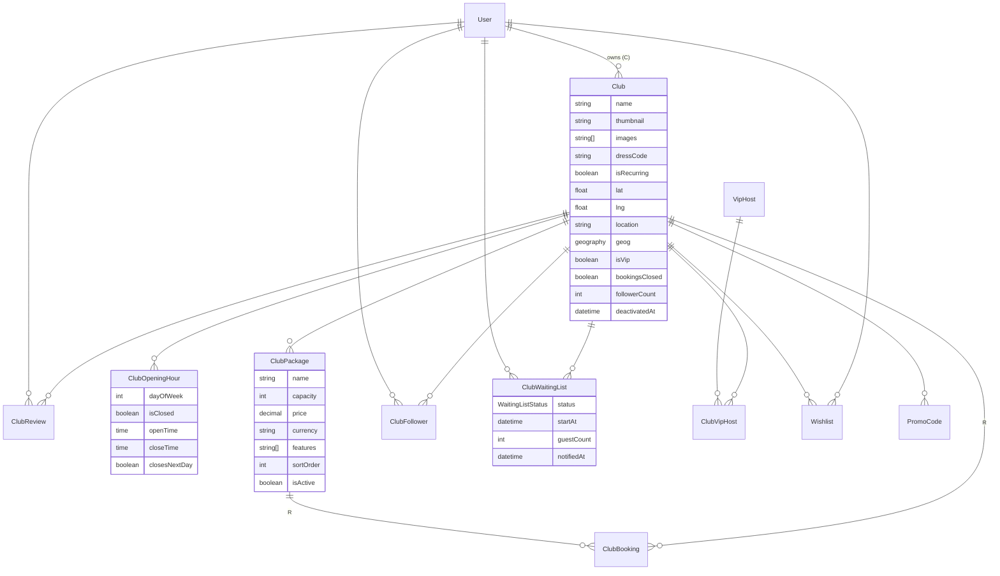
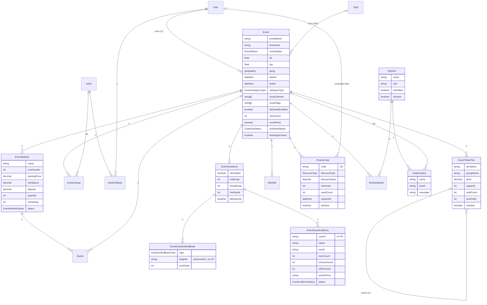
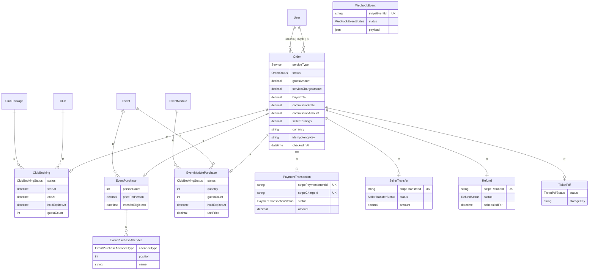

# Data Model (as-is)

> Reverse-engineered from `backend/prisma/schema.prisma` (999 lines) and `backend/prisma/migrations/` (25 migrations + `migration_lock.toml`).
> Describes the CURRENT state only. No changes are proposed here; see `known-issues.md` for problems.
> Items that could not be confirmed in code are marked **⚠️ UNVERIFIED**.

## 1. Overview

| Item | Value |
|---|---|
| Database | PostgreSQL 16 (dump header: 16.4 Debian) with PostGIS |
| ORM | Prisma ^6.19.2, `prisma-client-js`, preview feature `postgresqlExtensions` |
| Schema location | One schema for all three services: `backend/prisma/schema.prisma`. `server/prisma/`, `worker/prisma/`, `scheduler/prisma/` are empty mount points (`docker-compose.yaml` lines 66, 96, 130). |
| Counts | 41 models, 26 enums (verified with `grep -c "^model \|^enum "`) |
| Ids | `String @id @default(uuid())` on every model except `ServiceCharge` (`@default("GLOBAL")`) |
| Timestamps | `createdAt @default(now())` and `updatedAt @updatedAt` on every model except those noted "no updatedAt" below |
| Money | `Decimal(10,2)`; rates `Decimal(5,2)`; `currency` is a free `String` |
| Geo | `geog Unsupported("geography(Point,4326)")?` on `Club` and `Event`, GiST indexed, plus plain `lat`/`lng Float` |
| Extensions in schema | `postgis, fuzzystrmatch, postgis_tiger_geocoder, postgis_topology` (`schema.prisma:13`) |
| Extensions in migrations only | `btree_gist` (migration `20260923111443_booking_payment_foundation`) |
| Other raw SQL | `backend/scripts/seed-legal.sql` seeds `LegalContent` and `ApplicationCharge` (EVENT and CLUB at 10%) |
| Dump | `backend/bookdianight.dump`: PostgreSQL custom-format dump (`PGDMP` v1.15), database `bookdianight`. Not parsed. |

Legend used below: **C** = Cascade, **R** = Restrict, **SN** = SetNull, `uq` = unique, `ix` = index.

## 2. ERD (split by domain)

### 2.1 Accounts and config

`LegalContent`, `ApplicationCharge` and `ServiceCharge` have no relations (global config tables).

### 2.2 Clubs

### 2.3 Events and extras

### 2.4 Orders and payments

`WebhookEvent` has no relations (Stripe event dedupe log).

## 3. Enums (26)

| Enum | Values |
|---|---|
| AccountStatus | ACTIVE, INACTIVE, BLOCKED, DELETED |
| AccountRole | USER, ADMIN, CLUB_OWNER |
| Platform | ANDROID, IOS |
| Service | EVENT, CLUB |
| EventCategoryType | CLUB, CONCERT, FESTIVAL, OPEN_AIR, WAREHOUSE |
| DiscountType | PERCENTAGE, FIXED_AMOUNT |
| AuthProvider | MANUAL, GOOGLE, APPLE |
| NotificationType (31) | NEW_EVENT, NEW_CLUB, PAYMENT_SUCCESS, BOOKING_CONFIRMED, PAYMENT_RECEIVED, NEW_EVENT_NEARBY, NEW_CLUB_NEARBY, WISHLIST_EVENT_REMINDER, PAYMENT_FAILED, TICKET_AVAILABLE, CLUB_BOOKING_CONFIRMED, CLUB_BOOKING_EXPIRED, EVENT_REMINDER, CLUB_BOOKING_REMINDER, EVENT_CANCELED, REFUND_SCHEDULED, REFUND_PROCESSED, REFUND_FAILED, PASSWORD_RESET_SUCCESS, NEW_TICKET_SALE, NEW_CLUB_BOOKING, NEW_CLUB_REVIEW, STRIPE_CONNECT_SUCCESS, STRIPE_CONNECT_RESTRICTED, SELLER_TRANSFER_SUCCESS, SELLER_TRANSFER_FAILED, EVENT_CANCELED_SUCCESS, CLUB_SEAT_AVAILABLE, GUEST_LIST_CONFIRMED, GUEST_LIST_REJECTED, HOST_INQUIRY |
| Gender | MALE, FEMALE, OTHER |
| EventStatus | UPCOMING, ONGOING, COMPLETED, CANCELED |
| LegalContentType | ABOUT_US, TERMS_AND_CONDITION, PRIVACY_AND_POLICY |
| StripeConnectAccountStatus | PENDING, ACTIVE, RESTRICTED |
| OrderStatus | PENDING_PAYMENT, PAID, PAYMENT_FAILED |
| ClubBookingStatus | HOLD, BOOKED, EXPIRED (also reused by `EventModulePurchase.status`) |
| PaymentTransactionStatus | PENDING, PAID, FAILED |
| WebhookEventStatus | RECEIVED, PROCESSED, FAILED |
| SellerTransferStatus | PENDING, SUCCEEDED, FAILED |
| RefundStatus | SCHEDULED, PENDING, SUCCEEDED, FAILED |
| TicketPdfStatus | PENDING, GENERATED, FAILED |
| EventPurchaseAttendeeType | BUYER, FRIEND |
| WaitingListStatus | PENDING, NOTIFIED, CANCELLED |
| EventModuleStatus | AVAILABLE, LIMITED, SOLD_OUT, UNAVAILABLE |
| QuoteStatus | NEW, REPLIED, CLOSED |
| GuestListEntryStatus | PENDING, CONFIRMED, REJECTED |
| GuestListFallbackType | TICKET_TIER, MODULE, CLUB_PACKAGE, WAITING_LIST |
| ClubHostStatus | NONE, PENDING, APPROVED, REJECTED |

## 4. Models

Format: `field: type` with `?` = nullable, `[]` = array, `=x` = default. Line numbers refer to `schema.prisma`.

### 4.1 Accounts

**User** (204): `name: String`, `email: String uq`, `phoneNumber: String` (required), `accountStatus: AccountStatus =ACTIVE`, `accountRole: AccountRole =USER`, `isVerified: Boolean =false`, `password: String?`.
Indexes: `accountRole`, `accountStatus`. Back-relations: Profile, OAuthIdentity, Device, Notification, Club, Event, VipHost, StripeConnectAccount, Order (buyer and seller), ClubReview, ClubFollower, ArtistFollower, Wishlist, ClubWaitingList, PromoCode (createdBy).

**OAuthIdentity** (238, no updatedAt): `provider: AuthProvider`, `providerUserId: String`, `userId → User (C)`. uq `(provider, providerUserId)`, ix `userId`.

**Profile** (250): `userId → User (C) uq` (1:1), `location: String?`, `dateOfBirth: DateTime?`, `gender: Gender?`, `profileAvatar: String?`, `profileCover: String?`.

**Device** (263): `userId → User (C)`, `deviceIdentifier: String uq` (global), `fcmToken: String?`, `platform: Platform`, `authProvider: AuthProvider`, `isActive: Boolean =true`, `isLogout: Boolean =false`, `lastSeenAt: DateTime =now()`. ix `userId`, `(userId, isActive)`, `(isActive, lastSeenAt)`.

**Notification** (282): `userId → User (C)`, `notificationType`, `notificationTitle: String`, `notificationDescription: String?`, `isRead: Boolean =false`, `metaData: Json?`. ix `(userId, isRead)`, `createdAt`.

### 4.2 Config

**LegalContent** (298): `legalContentType: LegalContentType`, `content: String`. ix `legalContentType` (not unique).
**ApplicationCharge** (308): `serviceType: Service uq`, `chargePercentage: Decimal(5,2)`. Commission % per service.
**ServiceCharge** (316): `id: String ="GLOBAL"`, `amount: Decimal(10,2)`. DB CHECKs: `id='GLOBAL'`, `amount>0` (see section 5). Single buyer-fee row.

### 4.3 Clubs

**Club** (323): `userId → User (C)`, `name`, `description?`, `thumbnail`, `images: String[]`, `dressCode`, `isRecurring =false`, `lat: Float`, `lng: Float`, `location: String =""`, `geog: geography(Point,4326)?`, `isVip =false`, `website?`, `socialLinks: Json?`, `rulesAndVibe: String[] =[]`, `followerCount: Int =0`, `bookingsClosed =false`, `deactivatedAt: DateTime?`. ix `userId`, `(lat, lng)`, GiST `geog`.
**ClubReview** (363): `userId → User (C)`, `clubId → Club (C)`, `rating: Float`, `review: String?`. uq `(userId, clubId)`, ix `clubId`.
**ClubOpeningHour** (378): `clubId → Club (C)`, `dayOfWeek: Int`, `isClosed =false`, `openTime: Time(0)?`, `closeTime: Time(0)?`, `closesNextDay =false`. uq `(clubId, dayOfWeek)`.
**ClubPackage** (393): `clubId → Club (C)`, `name`, `description?`, `capacity: Int`, `price: Decimal(10,2)`, `currency`, `features: String[]`, `sortOrder =0`, `isActive =true`. uq `(clubId, name)`, ix `(clubId, isActive, sortOrder)`.
**ClubFollower** (750, no updatedAt): `userId → User (C)`, `clubId → Club (C)`. uq `(userId, clubId)`, ix `clubId`, `userId`.
**ClubWaitingList** (787): `clubId → Club (C)`, `userId → User (C)`, `status: WaitingListStatus =PENDING`, `startAt?`, `guestCount?`, `notifiedAt?`. uq `(userId, clubId, status)`, ix `(clubId, status)`, `userId`, `(clubId, startAt)`.

### 4.4 Events

**Event** (413): `userId → User (C)`, `clubId? → Club (SN)`, `eventName`, `eventDescription?`, `thumbnail`, `images: String[]`, `eventStatus =UPCOMING`, `lat`, `lng`, `location =""`, `geog?`, `startAt`, `endAt`, `dressCode`, `categoryType: EventCategoryType =CLUB`, `musicGenres: String[] =[]`, `moodTags: String[] =[]`, `isResaleEnabled =false`, `viewCount: Int =0`, `eventPrice: Decimal(10,2)` (legacy single price), `currency`, `clubHostStatus: ClubHostStatus =NONE`, `bookingsClosed =false`, `deactivatedAt?`. ix `userId`, `(clubId, clubHostStatus)`, `(eventStatus, startAt)`, `(lat, lng)`, GiST `geog`.
**EventTicketTier** (674): `eventId → Event (C)`, `parentId? → EventTicketTier (C)` (relation "TierChildren"), `tierName`, `groupName?`, `description?`, `price: Decimal`, `capacity: Int`, `soldCount: Int =0`, `sortOrder =0`, `startAt?`, `endAt?`, `isActive =true`. ix `(eventId, isActive, sortOrder)`, `parentId`.
**Artist** (698): `name`, `nameKey uq`, `avatar?`, `audioPreviewUrl?`, `spotifyUrl?`, `soundcloudUrl?`, `isVerified =false`, `followerCount =0`. ix `name`.
**ArtistFollower** (717, no updatedAt): `userId → User (C)`, `artistId → Artist (C)`. uq `(userId, artistId)`, ix `artistId`, `userId`.
**EventLineup** (730): `eventId → Event (C)`, `artistId? → Artist (SN)`, `artistName`, `artistAvatar?`, `audioPreviewUrl?`, `spotifyUrl?`, `soundcloudUrl?`, `isVerified =false`, `sortOrder =0`. ix `(eventId, sortOrder)`, `artistId`.
**Wishlist** (464): `userId → User (C)`, `eventId? → Event (C)`, `clubId? → Club (C)`. uq `(userId, eventId)`, `(userId, clubId)`, ix `userId`, `eventId`, `clubId`.
**PromoCode** (763): `code uq`, `discountType`, `discountValue: Decimal`, `maxUses: Int?`, `usedCount =0`, `expiresAt?`, `isActive =true`, `eventId? → Event (C)`, `clubId? → Club (C)`, `createdByUserId? → User (SN)`. ix `(code, isActive)`, `eventId`, `clubId`, `createdByUserId`.

### 4.5 Event extras

**EventModule** (808): `eventId → Event (C)`, `name`, `image?`, `description?`, `maxGuests: Int`, `startingPrice: Decimal`, `minSpend =0`, `deposit =0`, `currency`, `quantity: Int`, `remaining: Int`, `venueArea?`, `includedExtras: String[] =[]`, `optionalExtras: String[] =[]`, `status: EventModuleStatus =AVAILABLE`, `sortOrder =0`, `isActive =true`. ix `(eventId, isActive, sortOrder)`, `(eventId, status)`.
**Quote** (862): `eventId → Event (C)`, `moduleId → EventModule (C)`, `name`, `email`, `phone`, `guestCount`, `message`, `date?`, `status: QuoteStatus =NEW`. ix `(eventId, status, createdAt)`, `moduleId`.
**EventGuestList** (882): `eventId → Event (C) uq` (1:1), `isEnabled =false`, `daysBefore?`, `cutoffAt?`, `arrivalTimes: String[] =[]`, `maleCap?`, `femaleCap?`, `freeSpots?`, `dressCode?`, `idRequired =false`, `notes?`.
**EventGuestListFallback** (903): `guestListId → EventGuestList (C)`, `type: GuestListFallbackType`, `targetId: String` (polymorphic, no FK), `sortOrder =0`. ix `(guestListId, sortOrder)`.
**EventGuestListEntry** (916): `guestListId → EventGuestList (C)`, `userId: String?` (no relation), `name`, `email`, `phone`, `menCount`, `womenCount`, `otherCount` (all `=0`), `arrivalTime: String`, `status: GuestListEntryStatus =PENDING`, `acceptedTerms: Boolean`. ix `(guestListId, status, createdAt)`, `email`.

### 4.6 VIP hosts

**VipHost** (937): `ownerUserId → User (C)`, `name`, `role`, `isVerified =false`, `photo?`, `whatsapp?`, `phone?`, `email?`, `bio?`, `officialPricesNote?`, `isActive =true`. ix `(ownerUserId, isActive)`.
**EventVipHost** (961, no updatedAt): `eventId → Event (C)`, `hostId → VipHost (C)`. uq `(eventId, hostId)`, ix `hostId`.
**ClubVipHost** (973, no updatedAt): `clubId → Club (C)`, `hostId → VipHost (C)`. uq `(clubId, hostId)`, ix `hostId`.
**HostContact** (985, no updatedAt): `hostId → VipHost (C)`, `eventId? → Event (SN)`, `name`, `email`, `phone`, `message`. ix `(hostId, createdAt)`, `(eventId, createdAt)`.

### 4.7 Orders and payments

**Order** (495): `buyerUserId → User (R)` ("OrderBuyer"), `sellerUserId → User (R)` ("OrderSeller"), `serviceType: Service`, `status: OrderStatus =PENDING_PAYMENT`, buyer snapshot (`buyerName`, `buyerPhoneNumber`, `buyerDateOfBirth?`, `buyerGender?`, `buyerImage?`), amounts (`grossAmount`, `serviceChargeAmount`, `buyerTotal`, `commissionAmount`, `sellerEarnings`: all `Decimal(10,2)`; `commissionRate: Decimal(5,2)`), `currency`, `idempotencyKey: String`, `checkedInAt: DateTime?`. uq `(buyerUserId, idempotencyKey)`, ix `(buyerUserId, createdAt)`, `(sellerUserId, createdAt)`, `(serviceType, status, createdAt)`.
**ClubBooking** (534): `orderId → Order (R) uq`, `clubId → Club (R)`, `clubPackageId → ClubPackage (R)`, `status: ClubBookingStatus =HOLD`, `startAt`, `endAt`, `holdExpiresAt`, `guestCount`, snapshots `clubName`, `clubLocation`, `packageName`, `packageCapacity`. ix `(clubPackageId, status, startAt, endAt)`, `(status, holdExpiresAt)`, `(clubId, startAt)`.
**EventPurchase** (559): `orderId → Order (R) uq`, `eventId → Event (R)`, `personCount`, snapshots `eventName`, `eventLocation`, `eventStartAt`, `eventEndAt`, `pricePerPerson: Decimal`, `transferEligibleAt`. ix `(eventId, createdAt)`, `transferEligibleAt`.
**EventPurchaseAttendee** (581): `eventPurchaseId → EventPurchase (R)`, `attendeeType`, `position: Int`, `name`, `phoneNumber`, `gender?`, `age?`, `image?`. uq `(eventPurchaseId, position)`, ix `(eventPurchaseId, attendeeType)`.
**EventModulePurchase** (838): `orderId → Order (R) uq`, `eventId → Event (R)`, `moduleId → EventModule (R)`, `status: ClubBookingStatus =HOLD`, `quantity`, `guestCount`, `dateTime?`, `holdExpiresAt`, snapshots `moduleName`, `venueArea?`, `unitPrice`. ix `(moduleId, status)`, `(eventId, createdAt)`, `(status, holdExpiresAt)`.
**PaymentTransaction** (599): `orderId → Order (R) uq`, `stripePaymentIntentId? uq`, `stripeChargeId? uq`, `idempotencyKey uq`, `status: PaymentTransactionStatus =PENDING`, `amount`, `currency`. ix `(status, createdAt)`.
**WebhookEvent** (615): `stripeEventId uq`, `eventType`, `status: WebhookEventStatus =RECEIVED`, `payload: Json`, `processedAt?`. ix `(status, createdAt)`.
**SellerTransfer** (628): `orderId → Order (R) uq`, `stripeTransferId? uq`, `idempotencyKey uq`, `status: SellerTransferStatus =PENDING`, `amount`, `currency`, `completedAt?`. ix `(status, createdAt)`.
**Refund** (644): `orderId → Order (R) uq`, `stripeRefundId? uq`, `idempotencyKey uq`, `status: RefundStatus =SCHEDULED`, `amount`, `currency`, `scheduledFor`, `completedAt?`. ix `(status, scheduledFor)`.
**TicketPdf** (661): `orderId → Order (R) uq`, `status: TicketPdfStatus =PENDING`, `storageKey?`, `generatedAt?`. ix `(status, createdAt)`.
**StripeConnectAccount** (482): `userId → User (R) uq` (1:1), `stripeAccountId uq`, `status: StripeConnectAccountStatus =PENDING`, `onboardingCompletedAt?`. ix `status`.

## 5. Database rules that Prisma cannot express (from migrations)

All come from raw SQL in `20260923111443_booking_payment_foundation`, `20260923114448_refine_commission_rate_precision`, `20260923130000_add_order_purchase_idempotency`, `20260923080605_add_global_service_charge` and `20261101051000_allow_event_module_purchase`.

**CHECK constraints**
- `ServiceCharge`: `id = 'GLOBAL'`, `amount > 0`.
- `Order`: `serviceChargeAmount > 0`, `buyerTotal = grossAmount + serviceChargeAmount`, `commissionAmount = ROUND(grossAmount * commissionRate / 100, 2)`, `sellerEarnings = grossAmount - commissionAmount`.
- `ClubBooking`: `startAt < endAt`, `0 < guestCount <= packageCapacity`.
- `EventPurchase`: `personCount BETWEEN 1 AND 5`, `eventStartAt < eventEndAt`, `transferEligibleAt = eventStartAt - 6 hours`.
- `EventPurchaseAttendee`: `position BETWEEN 1 AND 5`, `age > 0`, FRIEND rows require `gender` and `age`.

**Unique and exclusion**
- Partial unique index `EventPurchaseAttendee_one_buyer_per_purchase_key` (`WHERE attendeeType = 'BUYER'`): one buyer per purchase.
- EXCLUDE constraint `ClubBooking_no_overlapping_active_intervals`: GiST on `(clubPackageId WITH =, tsrange(startAt, endAt) WITH &&) WHERE status IN ('HOLD','BOOKED')`. Requires `btree_gist`.

**Triggers and functions**
- `enforce_order_purchase_type`: BEFORE trigger on `ClubBooking`, `EventPurchase`, `EventModulePurchase`; checks the child matches `Order.serviceType`.
- `validate_order_purchase`: deferred constraint triggers on `Order`, `ClubBooking`, `EventPurchase`, `EventModulePurchase`; each Order must have exactly one matching child row in the same transaction.
- `validate_event_purchase_attendees`: attendee count must equal `personCount`, with exactly one BUYER.
- Snapshot immutability triggers on `Order`, `ClubBooking`, `EventPurchase`, `EventPurchaseAttendee`, `PaymentTransaction`, `SellerTransfer`, `Refund` (`Refund` also locks `scheduledFor`). `EventModulePurchase` has no such trigger.
- Migration `20260923130000_add_order_purchase_idempotency` replaces the snapshot trigger function so `idempotencyKey` is included.

**PostGIS `geog`**
- Declared as `Unsupported` in the schema (lines 336 and 425) and created in migration `20260913073135_y` with GiST indexes.
- No trigger fills it. The app writes it with raw `ST_MakePoint` in `server/src/app/modules/club/club.services.ts:49,189` and `event/event.services.ts:39,215`, and reads it with `ST_DWithin` in `explore/explore.services.ts:54,99`.
- Rows created any other way (seeds, other code paths such as `event.services.ts:582`) have `geog` NULL. **⚠️ UNVERIFIED** whether every update path refreshes it.

## 6. Migration history

| # | Folder | Summary |
|---|---|---|
| 1 | `20260913073135_y` | Extensions (postgis, fuzzystrmatch, postgis_tiger_geocoder, postgis_topology); 9 enums; User, Profile, Device, Notification, LegalContent, ApplicationCharge, Club, ClubReview, ClubOpeningHour, ClubPackage, Event, Wishlist; `geog` columns and GiST indexes |
| 2 | `20260913091454` | `Club.deactivatedAt` |
| 3 | `20260913102031_add_event_deactivated_at` | `Event.deactivatedAt` |
| 4 | `20260920060537_add_location_to_club_and_event` | `location TEXT NOT NULL DEFAULT ''` on Club and Event |
| 5 | `20260923080605_add_global_service_charge` | `ServiceCharge` with CHECKs |
| 6 | `20260923111443_booking_payment_foundation` | Stripe, Order, purchase and payment tables; 9 enums; `btree_gist`; CHECKs, EXCLUDE, triggers; `ApplicationCharge.serviceType` unique |
| 7 | `20260923114448_refine_commission_rate_precision` | `chargePercentage` and `commissionRate` DOUBLE to DECIMAL(5,2); recreates commission CHECK |
| 8 | `20260923130000_add_order_purchase_idempotency` | `Order.idempotencyKey` (backfilled with `id`, then NOT NULL), unique `(buyerUserId, idempotencyKey)`, trigger function update |
| 9 | `20260927081858_expand_notification_types` | 22 new `NotificationType` values |
| 10 | `20260928080131_add_deleted_status` | `AccountStatus.DELETED` |
| 11 | `20261003091258_add_checked_in_at_to_order` | `Order.checkedInAt` |
| 12 | `20261024083922_add_shotgun_features` | Club and Event discovery fields; `EventTicketTier`, `EventLineup`, `ClubFollower`, `PromoCode` |
| 13 | `20261024094524_add_waiting_list_and_club_events` | `Event.clubId`, `clubHostStatus`; `ClubWaitingList`; `CLUB_SEAT_AVAILABLE` |
| 14 | `20261027211302_add_promo_created_by_user` | `PromoCode.createdByUserId` |
| 15 | `20261101040000_add_event_modules_and_quotes` | `EventModule`, `EventModulePurchase`, `Quote` |
| 16 | `20261101051000_allow_event_module_purchase` | Raw SQL: trigger functions extended to `EventModulePurchase` |
| 17 | `20261101053000_add_event_guest_list` | `EventGuestList`, `EventGuestListFallback`, `EventGuestListEntry` |
| 18 | `20261101054500_add_vip_hosts` | `VipHost`, `EventVipHost`, `ClubVipHost`, `HostContact` |
| 19 | `20261101055500_add_bookings_closed` | `bookingsClosed` on Club and Event |
| 20 | `20261101061000_phase6_mood_artists_nested_tiers` | `EventTicketTier.parentId`; `Artist`, `ArtistFollower`; `EventLineup.artistId` |
| 21 | `20261101163000_waiting_list_slot_context` | `ClubWaitingList.startAt`, `guestCount`, index (uses `IF NOT EXISTS`) |
| 22 | `20261102104500_guest_list_entry_notifications` | `GUEST_LIST_CONFIRMED`, `GUEST_LIST_REJECTED` (`IF NOT EXISTS`) |
| 23 | `20261102154500_guest_list_entry_other_count` | `EventGuestListEntry.otherCount` |
| 24 | `20261103101500_host_inquiry_notifications` | `HOST_INQUIRY`; `HostContact.eventId` and index |
| 25 | `20261111120000_oauth_identity` | `OAuthIdentity` |

No migration drops a table. Schema/migration drift (what Prisma does not model): `btree_gist` missing from the schema `extensions` list, plus all section 5 objects.

## 7. Other data stores

**Redis / Valkey** (queues, cache, sessions). Key patterns:
- `user:session:<hash>`: hashed user refresh token, rotated on refresh. **⚠️ UNVERIFIED** (reported from `server/src/app/utils/session.utils.ts`, not re-read).
- `admin:session:<id>:<hash>`: admin sessions. **⚠️ UNVERIFIED** (same source).
- `blacklist:token:<token>`: revoked access tokens; prefix defined at `server/src/const.ts:294`. The auth and socket middlewares read `blacklist:jwt:<token>` instead (`auth.middlewares.ts:77`, `socket.middlewares.ts:48`; verified), so the two never match. See `known-issues.md`.
- OTP records and Stripe Connect callback tokens are stored in Redis; **⚠️ UNVERIFIED** exact key names.
- BullMQ queues: `email-queue`, `notification-queue`, `system-queue`.

**S3-compatible object storage**: uploads via `POST /media`, ticket PDFs referenced by `TicketPdf.storageKey`. **⚠️ UNVERIFIED** key naming and bucket layout.

**Client-side only**: Flutter keeps `accessToken`, `refreshToken`, `role`, `deviceIdentifier`, `fcmToken` in GetStorage; Admin keeps `adminData` and `csrfToken` in localStorage (`auth-storage`).
