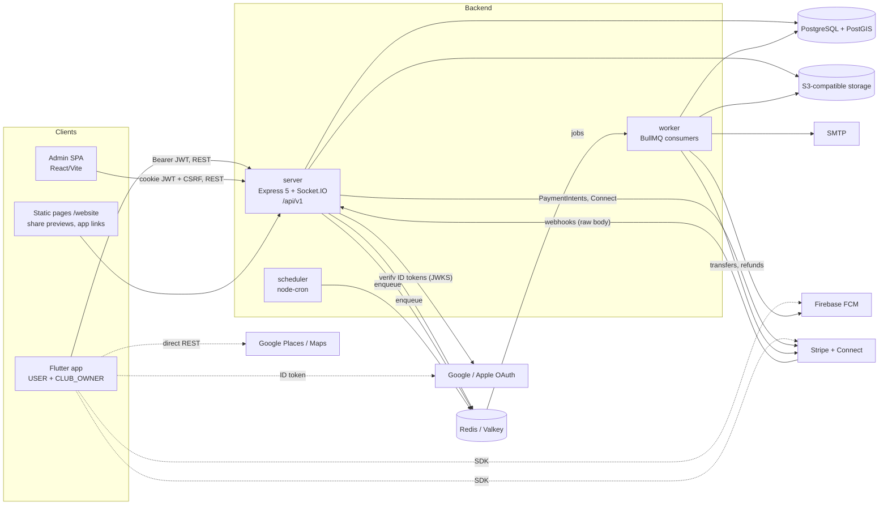
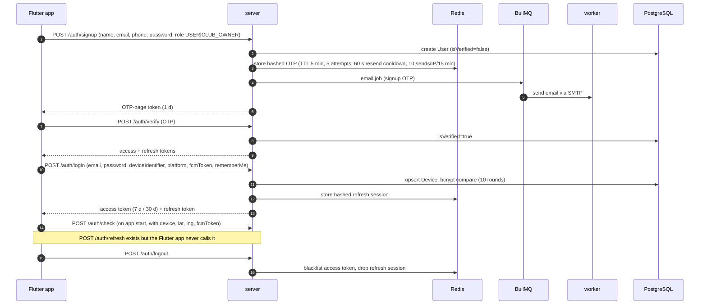
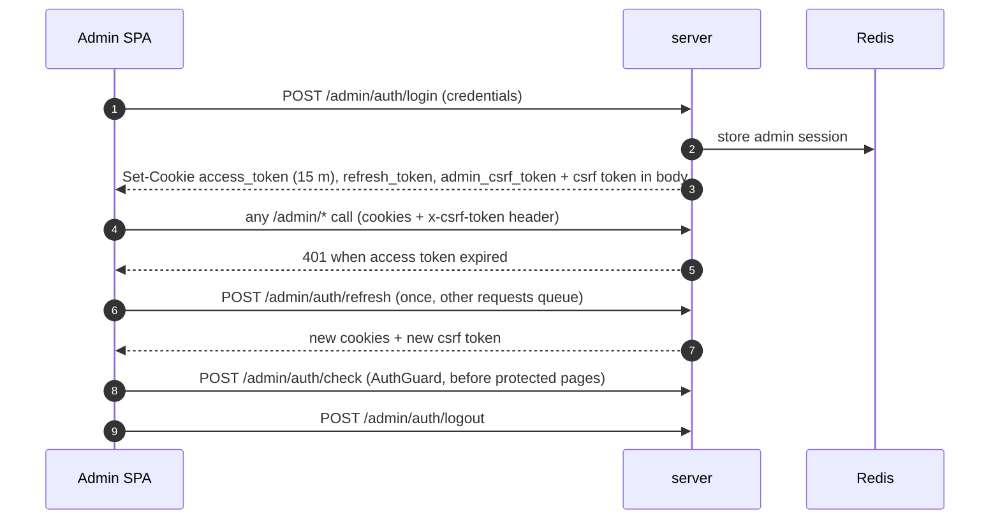
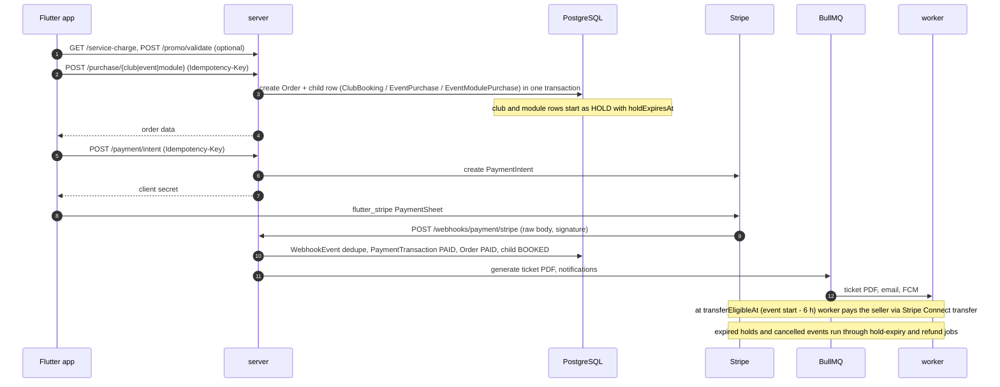

# System Architecture (as-is)

> Reverse-engineered from `backend/` (server, worker, scheduler, prisma), `admin/` and the Flutter app at `BookingDiaNight/` (the task called it `mobile-app`; no such folder exists).
> Current state only; no changes proposed. Uncertain items are marked **⚠️ UNVERIFIED**. Problems are listed in `known-issues.md`.
> Existing in-repo docs (`backend/docs/`, `.agent/blueprint.md`, `openapi.yaml`) were used only as cross-checks; the code is the source of truth.

## 1. Overview

BookDiaNight is a nightlife ticketing and club-booking platform.

| Actor | Role value | Uses |
|---|---|---|
| Customer | `USER` | Flutter app: browse, buy event tickets, book club tables and event modules, wishlist, follow, reviews, guest lists |
| Club manager | `CLUB_OWNER` | Flutter app (owner side): manage clubs, events, packages, modules, promos, hosts, waiting lists, scan tickets, Stripe Connect payouts |
| Admin | `ADMIN` | Admin web dashboard: users, commission and service charge, legal content, earnings, dashboard |

There is no ORGANIZER role. `CLUB_OWNER` is selectable at signup (see `known-issues.md`).

## 2. Components

| Component | Location | Role |
|---|---|---|
| **server** | `backend/server` | Express REST API under `/api/v1`, Socket.IO, Swagger UI, static pages, share-preview and app-link routes |
| **worker** | `backend/worker` | BullMQ consumer: email, FCM push, ticket PDFs, hold expiry, event status changes, Stripe transfers and refunds |
| **scheduler** | `backend/scheduler` | node-cron producer: enqueues jobs for the worker |
| **PostgreSQL + PostGIS** | compose image `postgis/postgis:16-3.4` | Primary data store (see `data-model.md`) |
| **Redis (Valkey)** | compose image `redis:latest` | BullMQ queues, user/admin sessions, token blacklist, OTP state, Connect callback tokens |
| **S3-compatible storage** | external (`S3_*` env) | Media uploads and ticket PDFs |
| **Flutter app** | `BookingDiaNight/` | Mobile client for both USER and CLUB_OWNER (read-only reference) |
| **Admin SPA** | `admin/` | React dashboard for ADMIN |
| **Stripe, Firebase, SMTP, Google, Apple** | external | See section 9 |

Shared code: the three backend services share one Prisma schema (`backend/prisma/`) and a common `@/` import alias style; each has its own `env.ts` and `const.ts`.

## 3. Tech stack

| Component | Stack |
|---|---|
| Backend (all) | Node 22 (`node:22-alpine`), TypeScript ^7.0.2, tsx + nodemon, Prisma ^6.19.2 |
| server | Express ^5.2.1, Socket.IO ^4.8.3, Zod ^4.4.3, BullMQ ^5.67.2 (producer), ioredis ^5.6.0, jsonwebtoken, bcrypt, helmet, cors, morgan, cookie-parser, swagger-ui |
| worker | BullMQ ^5.67.2 (consumer), nodemailer + Handlebars, firebase-admin, Stripe, pdfkit, puppeteer, qrcode |
| scheduler | node-cron ^4.5.0, BullMQ producer |
| Admin | React ^19.2, Vite ^8.2, TypeScript ~6.0, React Router ^7.18, TanStack Query ^5.101, axios ^1.19, zustand ^5, react-hook-form + zod, Tailwind ^3.4 + shadcn/ui (Radix), recharts, jodit-react, i18next (en, it) |
| Flutter | Dart ^3.10.3, GetX ^4.7.2 (state, routing, DI), dio ^5.9, get_storage, flutter_dotenv, firebase_core/messaging, flutter_stripe ^12.6, google_sign_in ^6.2.1, sign_in_with_apple ^8.2, google_maps_flutter, geolocator, mobile_scanner, app_links |

Versions are from `CLAUDE.md`, `package.json` and `pubspec.yaml` (as reported; **⚠️ UNVERIFIED** against lock files).

Local run: `docker-compose.yaml` defines postgres, redis, redis-ui, scheduler, worker, server on network `bookdianight-network`. API at `127.0.0.1:5005/api/v1`. Production host is `https://api.bookdianight.com` per `CLAUDE.md`; the Admin app's `.env` points at a different host (`https://ibady.nazmul.qzz.io/api/v1`), and `app.ts:173` hardcodes that host for Swagger. **⚠️ UNVERIFIED** which one is live.

## 4. Component diagram

## 5. Server internals

### 5.1 Request pipeline (`server/src/app.ts`)

Order of `app.use` registrations: `traceMiddleware` (adds `traceId`), JSON body parser (skipped for `/webhooks/payment/stripe` and `/api/v1/connect/webhook`, which use `raw()` in the route), `urlencoded`, `trust proxy = 1`, `cookieParser`, `cors` (whitelist in `const.ts`), `morgan`, `helmet`, `/health`, `/api-docs` (Swagger UI from the nearest `openapi.yaml`), v1 router at `/api/v1`, static pages, JSON 404, `globalErrorMiddleware`.

### 5.2 Routing and module layout

- `server/src/app/routes/v1/index.ts` mounts 27 module routers at `/api/v1` (`baseUrl.v1`). There is no per-module prefix; each `*.routes.ts` writes full paths (for example `/auth/login`). `baseUrl.v2` exists but is unused.
- Each module in `server/src/app/modules/<name>/`: routes, middlewares, schema (Zod), controllers, services.
- Validation helpers `validateReqBody`, `validateReqQuery`, `validateReqParams` live in `server/src/app/utils/system.utils.ts`.
- Modules (27): admin, artists, auth, bookings, club, connect, event, eventModule, explore, follow, guestList, hosts, legal, media, notification, owner, payment, profile, promo, purchase, quotes, recover, reviews, serviceCharge, waitingList, webhook, wishlist.
- 139 routes in total under `/api/v1`, confirmed by an independent count of `.get/.post/.put/.patch/.delete(` calls in the 27 `*.routes.ts` files. `api-spec.yaml` has 151 operations: those 139 plus 12 root-level routes from `app.ts`.

### 5.3 Routes outside `/api/v1` (`app.ts`)

`GET /health` (DB `SELECT 1` and Redis ping with 3 s timeout; 200 `ok` or 503 `degraded`), `/api-docs`, `/` (redirects to `/website`), `/website`, `/marketing`, `/support`, `/privacy` (+ `/privacy-policy`), `/assets`, `/.well-known/apple-app-site-association`, `/.well-known/assetlinks.json`, `GET /explore/club/:id` and `/explore/event/:id` (share previews), `GET /connect/complete` (inline HTML fallback), JSON 404 for everything else.

### 5.4 Error handling

`server/src/app/middlewares/globalError.middlewares.ts`. There are no custom error classes: services throw plain objects `{ statusCode, message, errorType? }` (`errorType` from the `AuthErrorType` enum in `const.ts`). Statuses 400 to 499, 502 and 503 pass through as `{ success: false, message, errorType?, traceId }`. Malformed JSON becomes 400 "Invalid JSON Payload". Anything else becomes 500 "Internal Server Error" with `traceId`. Many middlewares answer 401/403 directly instead of calling the handler. The 404 shape is `{ success, message, error }`.

### 5.5 Real-time

`server/src/app/configs/socket.config.ts`: default namespace only, authenticated by `socketAuthMiddleware` (Bearer token from `handshake.auth.token` or the Authorization header). `chatNameSpace` and `notificationNameSpace` are declared but never initialised, and `SOCKET_EVENTS` (`notification:*`) is never emitted. The Flutter app has no socket client and the Admin app does not use sockets. Push notifications use FCM only.

## 6. Authentication and authorization

### 6.1 Tokens and sessions

| Token | Secret env | Lifetime | Carried by |
|---|---|---|---|
| User access | `JWT_ACCESS_TOKEN_SECRET_KEY` | 7 d, or 30 d with `rememberMe` (`jwt.utils.ts`) | `Authorization: Bearer` |
| User refresh | `JWT_REFRESH_TOKEN_SECRET_KEY` | 3 d, or 30 d with `rememberMe`; contains `jti` | request body (`POST /auth/refresh`) |
| Admin access | `JWT_ACCESS_TOKEN_SECRET_KEY` (same as user) | 15 m | httpOnly cookie `access_token` |
| Admin refresh | refresh secret | refresh lifetime as above (**⚠️ UNVERIFIED**) | httpOnly cookie `refresh_token` |
| OTP page | `JWT_VERIFY_OTP_PAGE_SECRET_KEY` | 1 d | header used by `/auth/verify`, `/auth/resend` |
| Reset page | `JWT_RESET_PASSWORD_TOKEN_SECRET_KEY` | 15 m | used by `/recover/*` |

`const.ts` also declares `userAccessTokenExpiresIn = '30d'`, which does not match the hard-coded 7 d / 30 d in `jwt.utils.ts` (**⚠️ UNVERIFIED** whether the constant is read anywhere).

Redis state (see `data-model.md` section 7): hashed refresh sessions rotated on each refresh, admin sessions, a revoked-token blacklist, OTP state (`user:otp`, `user:otp:attempts`, `user:otp:resend`, `user:otp:ip`; prefixes at `const.ts:290-293`). Devices are bound: the JWT carries `deviceId` and `checkDeviceContextMiddleware` compares it with `deviceIdentifier` in the body.

Middleware shorthand used in the API spec:
- **U** = `checkUserAccessTokenMiddleware` + `checkUserExistenceMiddleware` + `checkAccountStatus`
- **O** = U + `checkClubOwnerRoleMiddleware`
- **C** = `checkConnectReadinessMiddleware` (owner has an active Stripe Connect account)
- **A** = `checkAdminAccessTokenMiddleware` + `checkAdminExistenceMiddleware` (enforces ADMIN role)
- **csrf** = `checkCsrfTokenMiddleware` (cookie `admin_csrf_token` must equal header `x-csrf-token`)

### 6.2 User signup, login and refresh

This diagram is a simplified flow. The exact request and response fields are in `api-spec.yaml` (`/auth/*`); whether `/auth/verify` itself returns tokens or only marks the account verified is **⚠️ UNVERIFIED** here, so check that operation.

### 6.3 Social login

`POST /auth/social` takes `{ provider, idToken, nonce }`. `server/src/app/utils/oauthToken.utils.ts` verifies Google and Apple ID tokens against the providers' JWKS and checks audience and nonce. Env: `GOOGLE_OAUTH_CLIENT_IDS`, `GOOGLE_OAUTH_AUTHORIZED_PARTIES`, `APPLE_OAUTH_CLIENT_IDS`, read directly from `process.env` (optional, not through `getEnv`). Identities are stored in `OAuthIdentity`; `Device.authProvider` records the provider.

### 6.4 Password recovery

`POST /recover/find` → OTP email; `POST /recover/verify` → reset-page token (15 m); `POST /recover/reset`; `POST /recover/resend`. Same OTP policy as signup (`otp.utils.ts`, `otpPolicy.ts`). OTPs come from `crypto.randomInt` and are stored hashed with `OTP_HASH_SECRET`.

### 6.5 Admin

The SPA keeps `adminData` and `csrfToken` in localStorage (`auth-storage`, zustand persist). The CSRF check is applied to all admin routes except two GETs (`/admin/profile`, `/admin/commission`).

### 6.6 Authorization model

Roles come from `AccountRole`. Ownership checks (club, event, waiting-list notify, promo) happen in services, not in middleware; promo routes use U only (see `known-issues.md`). `media` routes have no auth middleware.

## 7. Payments and bookings

- Fees: `Order.serviceChargeAmount` (global buyer fee from `ServiceCharge`) and `Order.commissionRate` (from `ApplicationCharge` per service). Database CHECKs enforce the arithmetic (`data-model.md` section 5).
- Club owners must complete Stripe Connect Express onboarding (`POST /connect/onboarding`, `GET /connect/status`, `GET /connect/return`, `GET /connect/refresh`, webhook `POST /connect/webhook` for `account.updated`). Routes marked C require an active account.
- Stripe code: `server/src/app/configs/stripe.configs.ts`, `modules/connect/connect.services.ts:126,150`, `modules/webhook/webhook.services.ts`; worker transfers `processSellerTransfer.job.ts:123`, refunds `processRefund.job.ts:118`.
- Event tickets: 1 to 5 people per purchase, one BUYER attendee plus FRIENDs.
- Club bookings: `ClubBooking_no_overlapping_active_intervals` prevents double booking of a package.
- Exact webhook event types handled beyond `payment_intent.*` and `account.updated`: **⚠️ UNVERIFIED**.

## 8. Background processing

Queues (3 attempts with backoff, `*/configs/queue.configs.ts`); workers auto-load from `worker/src/app/queues/<name>/<name>.workers.ts`; job names in `QUEUE_JOBS` (`const.ts`).

| Queue | Jobs |
|---|---|
| `email-queue` | signup OTP, resend OTP, signup success (x2), recover OTP, recover resend, recover reset success, host contact, club waiting list, event cancellation, ticket PDF email |
| `notification-queue` | `send-fcm-notification` |
| `system-queue` | expire club booking hold, expire event module hold, generate ticket PDF, make event ongoing, make event completed, process seller transfer, process refund |

Cron jobs (`scheduler/src/app/jobs/*/*.tasks.ts`, auto-registered):

| Job | Schedule | Action |
|---|---|---|
| `syncEventStatus` | every minute | enqueue MAKE_EVENT_ONGOING / MAKE_EVENT_COMPLETED |
| `recoverTicketPdfs` | every 15 min | re-queue stuck or missing ticket PDFs (deterministic jobId) |
| `dispatchReminders` | hourly | event, club-booking and wishlist FCM reminders |
| `cleanupIncompleteUsers` | daily 00:00 | delete unverified users older than 24 h |

There is no distributed lock in the scheduler, so more than one instance would enqueue duplicates (see `known-issues.md`).

## 9. Third-party integrations

| Service | Used for | Where | Config |
|---|---|---|---|
| Stripe | PaymentIntents, Connect Express accounts, account links, transfers, refunds, webhooks | server `configs/stripe.configs.ts`; worker jobs; Flutter `flutter_stripe` | `STRIPE_*` (3 vars), `STRIPE_CONNECT_PUBLIC_BASE_URL`, `FLUTTER_CONNECT_APP_LINK_URL`; Flutter `STRIPE_PUBLISHABLE_KEY` |
| Firebase Cloud Messaging | Push notifications | worker `configs/firebase.configs.ts` (firebase-admin); Flutter `firebase_messaging` | `FIREBASE_*` (9 vars) |
| SMTP (nodemailer) | Transactional email, Handlebars templates in `worker/src/app/templates/` | worker `configs/nodemailer.config.ts` | `SMTP_*` |
| S3-compatible storage | Media and ticket PDFs | server `configs/s3Client.configs.ts`, `utils/s3.utils.ts` (AWS SDK v3, custom endpoint, presigner); worker has a copy | `S3_*` |
| Google / Apple sign-in | ID token login | server `oauthToken.utils.ts`; Flutter `sign_in_controller.dart` | see 6.3 |
| Google Maps / Places | Maps SDK in Flutter; Places (New) called directly from the app with `X-Goog-Api-Key` | Flutter `explore_repository.dart`, `club_location_repository.dart` | `MAP_API_KEY` in Flutter `.env` |
| PostGIS, geo-tz | Nearby search, time zones | server explore and wishlist services via `$queryRaw` | database extension |
| puppeteer, pdfkit, qrcode | Ticket PDF and QR | worker `utils/pdf.utils.ts` | optional `PUPPETEER_EXECUTABLE_PATH` |
| Apple/Android app links | Deep links to `/explore/club/<id>`, `/explore/event/<id>` | server `.well-known` routes; Flutter `app_links` | n/a |

## 10. Configuration

Names only, no values.

- **server** (`server/src/env.ts`): `NODE_ENV`, `SERVER_URL`, `DATABASE_URL`, `REDIS_*`, `PORT`, 4 JWT secrets (`JWT_ACCESS_TOKEN_SECRET_KEY`, `JWT_REFRESH_TOKEN_SECRET_KEY`, `JWT_VERIFY_OTP_PAGE_SECRET_KEY`, `JWT_RESET_PASSWORD_TOKEN_SECRET_KEY`), `S3_*`, `OTP_HASH_SECRET`, 3 `STRIPE_*`, `STRIPE_CONNECT_PUBLIC_BASE_URL`, `FLUTTER_CONNECT_APP_LINK_URL`, plus `REDIS_TLS` from `process.env`. `.env.example` lacks `SERVER_URL`, which `getEnv` requires.
- **worker** (`worker/src/env.ts`) and **scheduler** (`scheduler/src/env.ts`): own env files (**⚠️ UNVERIFIED** full lists).
- **Flutter** (`.env` bundled as an asset; not on disk and no example): `BASE_URL`, `LOCAL_BASE_URL`, `SOCEKT_URL` (typo as in code), `MAP_API_KEY`, `STRIPE_PUBLISHABLE_KEY`. `flavor_config.dart` hardcodes `isProduction = true`.
- **Admin**: `VITE_API_URL` (required at startup), `vite.config.ts` allows host `bookdianight-admin.localbox.online`.

Deployment:
- Backend: Docker images; production runs built images (`CLAUDE.md`), `infrastructure/` and `scripts/vps-*.sh` are production-only. Details of the VPS are in `.agent/blueprint.md` (not copied here).
- Admin: DigitalOcean App Platform via `.github/workflows/deploy.yml` on tag push.
- Flutter: no CI configuration inspected. **⚠️ UNVERIFIED**.

## 11. Client architectures

**Flutter** (`BookingDiaNight/lib`): GetX modules at `app/modules/<feature>/{controllers,views,repository,model}`, split into `user_side/` and `club_owner_side/`. HTTP through a singleton Dio `BaseClient` (`core/network/base_client.dart`) with `validateStatus: (_) => true` and manual exception mapping. Endpoint constants in `core/network/end_point.dart` (about 15 paths are hardcoded in repositories). No auth interceptor: each repository adds `Authorization: Bearer`. Tokens in GetStorage. Session checked at splash with `POST /auth/check`. No refresh flow, no socket client.

**Admin** (`admin/src`): feature folders plus `apis/*.api.ts` hooks (`useXQuery` / `useXMutation`), axios instance in `configs/axios.configs.ts` (`withCredentials`, CSRF header, single-flight refresh on 401), route guard `components/guards/AuthGuard.tsx`. Some pages are still mock-only (notifications, dashboard metrics hook); see `api-usage-map.md`.
